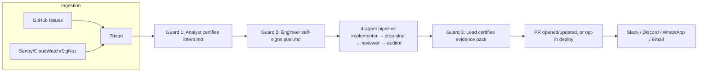

# Lodestar

> Autonomous, spec-driven, multi-repo software factory for vibecoders — one person or a small team. Monitors incidents, fixes GitHub issues, watches codebases for regressions, and ships evidence-certified PRs through Relay's Guard 1/2/3 methodology.

**Status: implemented.** 16 dashboard screens, the full Relay Guard 1/2/3 pipeline, 5 model adapters (Claude/Gemini/Kimi/DeepSeek/OpenAI), the fleet supervisor, both knowledge backends, and the Clarity `behavior-monitor` worker (Phase 7 — awaiting one live Clarity run, see `impl.md` §3) are built and covered by 286 passing tests (`bun test`). Open items are tracked in [`docs/progress.md`](docs/progress.md). Every `.ts` file path below is a real file, not a plan — this README documents the actual structure, kept in sync with `impl.md`'s phase checklist as work continues.

---

## Table of Contents
1. [Documentation Map](#documentation-map)
2. [Architecture Overview](#architecture-overview)
3. [Directory Structure](#directory-structure)
4. [Application Flow](#application-flow)
5. [Feature / Module Responsibilities](#feature--module-responsibilities)
6. [Development Setup](#development-setup)
7. [Environment Configuration](#environment-configuration)
8. [Scripts](#scripts)
9. [Testing Strategy](#testing-strategy)
10. [API / Data Flow](#api--data-flow)
11. [State Management](#state-management)
12. [Deployment](#deployment)
13. [Docker Usage](#docker-usage)
14. [Coding Conventions](#coding-conventions)
15. [Architectural Rules](#architectural-rules)
16. [Troubleshooting](#troubleshooting)

---

## Documentation Map

Don't duplicate content already written elsewhere — this README is the on-ramp; these are the sources of truth:

| Doc | Covers |
| :--- | :--- |
| `architecture.md` | Full design: C4 diagrams, Relay Guard 1/2/3 semantics, module tree, job types, cross-repo fan-out, release tagging (§10). |
| `plan.md` | Product vision, tech stack decisions, phased roadmap, Definition of Success, Cycle Time/Evidence/Rollback metrics formulas (§7). |
| `impl.md` | **File-level build plan**: module map, layered directory refinement (§1a), data contracts, 6+ implementation phases with done-when checks, known open gaps. |
| `deployment.md` | VM sizing, cloud-init, systemd unit, Docker, SigNoz/measure-sh setup. |
| `progress.md` | **Living status ledger**: verified findings, what's fixed, what's still open, and the next tasks in priority order. |
| `herdr.md` | Evaluation of herdr (Rust PTY/agent workspace runtime) as an optional execution backend; recommendation: keep the native engine. |
| `screen-list.md` | All 16 dashboard screens' UI components and data-access notes. |
| `mock-ui.html` | The dashboard's executable visual spec — build `src/dashboard/` to match this 1:1. |
| `.env.example` | Every environment variable, with inline comments. |
| `skills/lodestar/SKILL.md` | The CLI commands this project ships as an installable Agent Skill. |

## Architecture Overview

Lodestar adopts three external methodologies wholesale rather than reinventing them (`plan.md` §2):
- **Hanoi Rainbow** — Spec-Driven Development. Every track gets `intent.md`/`spec.md`/`design.md`/`plan.md` before code changes.
- **Relay** — Guard 1 (Analyst certifies intent) → Guard 2 (Engineer self-signs plan) → Guard 3 (Lead certifies evidence, no bypass, ever). See `architecture.md` §1.
- **Machinist** — Control Plane vs. Worker Plane separation; a named worker per track, in its own Git worktree.

On top of those: a plugin/interface-segregated core (`core/interfaces/`, `event-bus.ts`, `registry.ts`), a pluggable multi-model layer (Claude/Gemini/Kimi/DeepSeek, one provider per agent role), a pluggable knowledge backend (LoadstoneNexus MCP or Obsidian, same contract either way), and a server-rendered Bun dashboard with no frontend framework.



Full C4 context/container diagrams and the Guard sequence diagrams: `architecture.md` §3. The Cross-Repo Fan-Out / Instrumentation Campaign flow: `architecture.md` §9's Level 4 diagram.

## Directory Structure

The authoritative tree is `architecture.md` §1; `impl.md` §1a refines it with explicit layers inside `src/dashboard/`. Summary:

```
src/
├── config/            # .env loading, typed Config — leaf, no business logic
├── core/               # interfaces, event-bus, engine (Guard state machine), registry
├── adapters/           # anthropic/gemini/kimi/deepseek — one file per model provider
├── services/           # domain logic: memory, planning (SDD), log, monitor, agent (fleet) services
├── plugins/{agents,tools,memory}/   # swappable units registered via core/registry.ts
├── data-access/        # thin IO clients (GitHub API, MCP transport, Fleet DB queries) — no business logic
├── shared/{ui,utils,types}/         # feature-agnostic; never imports features/ or services/
├── state/              # process-local runtime state (SSE hub) — not a domain store
├── dashboard/
│   ├── server.ts        # Bun.serve() bootstrap + route table only
│   └── features/        # one folder per screen-list.md screen (stats, releases, fleet, ...)
│       └── <name>/{ui,use-cases,*.test.ts}
└── cli/index.ts        # run / daemon / dashboard / init-knowledge / sentinel-test / status
e2e/                    # cross-feature end-to-end tests (real disposable GitHub repo)
flight-deck/tracks/<track_id>/     # per-track Guard documents (intent/spec/design/plan/evidence)
.worktrees/<track_id>/             # isolated Git worktree per in-flight track
deploy/                # systemd unit template, cloud-init.yaml, setup-vm.sh (deployment.md)
```

## Application Flow

1. **Ingestion** — a GitHub issue, a Sentry/CloudWatch/SigNoz signal, or a commit/deploy event enters Triage (`architecture.md` function-diagram.md Layer 1–2).
2. **Triage** assigns an archetype (A/B/C/H) and opens `flight-deck/tracks/<track_id>/`.
3. **Guard 1** (skipped for C/H) — Analyst certifies `intent.md`.
4. **Guard 2** (skipped for C/H) — Engineer (the LLM agent) self-signs `plan.md`, unless the change touches a gated path (PII/auth/authz/audit-logging), which forces a human sign.
5. **Build → Verify → Ship** — the 4-agent pipeline (`relay-implementer` → `relay-stop-slop` → `relay-reviewer` → `relay-auditor`) produces the evidence pack.
6. **Guard 3** (always, no bypass) — Lead certifies `guard-evidence.md`/`evidence.json`.
7. **Delivery** — a new PR (Issue/Incident Monitor), an update to an existing PR (Codebase Monitor), a bulk PR set (Instrumentation Campaign), or an opt-in automated deploy with auto-rollback on failure (`plan.md` §7.3).
8. **Notification** — Slack/Discord/WhatsApp/Email, tracked per-run in the dashboard's Notified column.

A track whose fix touches a shared cross-repo contract fans out into one child track per affected repo instead of step 3–7 running once (`architecture.md` §9).

## Feature / Module Responsibilities

One dashboard feature per `screen-list.md` screen — each is `dashboard/features/<name>/`:

| Feature | Screen | Responsibility |
| :--- | :--- | :--- |
| `stats` | My Stats + Per-Repo Stats | Org-wide and per-repo token/spend/MCP-call rollups. |
| `relay-pipeline` | Relay Pipeline & Guard Control | Live 6-stage operational pipeline & Guard 1/2/3 lifecycle. |
| `fleet` | My Fleet & Agent Supervisor | Worker process table, job/model assignment, live stdout/stderr. |
| `amp-mesh` | AMP Mesh & Gateways | Peer mesh graph, inter-agent message feed, gateway connection status. |
| `knowledge` | CodeGraph & Graft | AST symbol hierarchy, module API explorer, solution history. |
| `memories` | LoadstoneNexus/Obsidian Memory | Branch recall, decision journal, Guard Document Browser, living docs. |
| `history` | Run History & Savings | Per-track resolution record + ROI, tabbed by job type. |
| `releases` | Release Tracker + Create Release | Tag/changelog history (§7b) and the tag-cutting form (§7c) — `architecture.md` §10. |
| `agents-log` | Agents Log | Unified cross-agent log stream, dev-journal persistence status. |
| `setup` | Skill Install | First-run install steps only. |
| `monitor-setup` | Monitor Setup & Campaigns | Telemetry monitor setup, target repo selector, and multi-repo campaign execution. |
| `configuration` | Configuration | Env config, knowledge backend, gateways, fleet defaults — separate from Setup. |

Non-dashboard modules (`services/`, `adapters/`, `plugins/`, `core/`) implement the actual autonomous behavior these screens observe — see `impl.md` §1 for the full module map with dependencies.

## Development Setup

1. Install Bun (`curl -fsSL https://bun.sh/install | bash`).
2. `cp .env.example .env` and fill in at minimum: `GITHUB_TOKEN`, `GITHUB_REPO`, and the API key for whichever `PRIMARY_AUTO_CODER` you set.
3. `skill install lodestar` to make the CLI commands available to Claude Code/Gemini/other harnesses (`skills/lodestar/SKILL.md`).
4. `bun install`, then `bun run src/cli/index.ts status` to sanity-check config loads.

## Environment Configuration

Full reference: `.env.example` (every var has an inline comment). Grouped:

- **Relay/Team**: `TEAM_MODE` (solo/team), `ANALYST_NAME`/`LEAD_NAME` (team only), `ALLOW_AUTONOMOUS_INCIDENT_DECLARATION`.
- **GitHub**: `GITHUB_TOKEN`, `GITHUB_REPO` (comma-separated, multi-repo), `GITHUB_BASE_BRANCH`, `ISSUE_LABEL_FILTER`.
- **Auto-coder providers**: `PRIMARY_AUTO_CODER`/`FALLBACK_AUTO_CODERS`, plus per-provider `*_API_KEY`/`*_MODEL`/`*_BASE_URL` for Anthropic, Gemini, Kimi, DeepSeek, and OpenAI (`openai-adapter.ts`).
- **Fleet & dashboard**: `DASHBOARD_PORT`, `AGENT_COUNT`, `AGENT_N_PROVIDER`/`AGENT_N_JOB` per worker.
- **Rate-limit sentinel**: `AUTO_WAIT_ON_RATE_LIMIT`, `RATE_LIMIT_WAIT_BUFFER_SECONDS`, `MAX_RATE_LIMIT_WAIT_MINUTES`.
- **Knowledge backend**: `KNOWLEDGE_BACKEND` (`loadstonenexus`/`obsidian`), then either `DATA_DIR`/`KNOWLEDGE_BASE_DIR`/`LOADSTONENEXUS_MCP_MODE`/`LOADSTONENEXUS_MCP_URL`, or `OBSIDIAN_VAULT_PATH`/`OBSIDIAN_MCP_URL`/`OBSIDIAN_API_KEY`.
- **Gateways**: `SLACK_WEBHOOK_URL`, `DISCORD_WEBHOOK_URL`, `WHATSAPP_API_TOKEN`/`WHATSAPP_BROADCAST_LIST`, `SMTP_URL`/`ALERT_EMAIL_TO` — all independently optional.
- **SDD**: `AUTO_SEMANTIC_COMMITS` — specifications and Baton artifacts are generated into `flight-deck/tracks/<track_id>/`.
- **Daemon**: `POLL_INTERVAL_SECONDS`.

## Scripts

CLI subcommands (`skills/lodestar/SKILL.md`), invoked as `bun run src/cli/index.ts <subcommand>`:

| Command | Purpose |
| :--- | :--- |
| `run --issue <N> --repo <owner/repo> [--provider ...]` | Resolve one issue end-to-end. |
| `daemon --interval 60` | Continuous multi-repo poller (reads `GITHUB_REPO`). |
| `dashboard --port 3000` | Start the live operations dashboard. |
| `init-knowledge` | Index a repo's CodeGraph/Graft knowledge into the configured backend. |
| `sentinel-test` | Exercise rate-limit hold/resume logic without a real 429. |
| `status` | Config + fleet health snapshot. |

## Testing Strategy

Full detail: `impl.md` §5. Summary:
- **Unit/integration**: co-located `*.test.ts` next to the file it tests, run with `bun test` — no separate framework, no fixtures beyond what `bun test` gives natively.
- **E2E**: top-level `e2e/`, against a real disposable GitHub repo — GitHub's API is not mocked for this tier, per this project's own bias toward integration tests hitting the real thing.
- **Gated paths** (PII/auth/authz/audit-logging): Opengrep SAST required before merge — no exceptions, including on Lodestar's own eventual codebase.
- **Per-phase acceptance**: each of `impl.md` §3's phases has a concrete "done when" — e.g. Phase 1 is done when `run` opens a real PR end-to-end with no human step; Phase 5b is done when a simulated failed health check triggers an automatic revert and a fresh archetype-H track.

## API / Data Flow

No service reads/writes `$DATA_DIR` or a vault directly — everything goes through the `memory-interface.ts` contract in `data-access/`/`services/memory-service/`:
```ts
persist_knowledge(collection, doc) / retrieve_knowledge(collection, query?)
persist_decision(trackId, quote, tags)
persist_guard_document(trackId, kind, content) / retrieve_guard_document(trackId, kind?)
```
Full contract + the two backend implementations: `impl.md` §2.2. External API calls live in `plugins/tools/` (GitHub issues/PRs, git tags) and `data-access/` (Clarity Data Export, MCP); the planned `data-access/github-client.ts`, `services/log-service/` (Sentry/CloudWatch/SigNoz webhooks) and Slack/Discord/WhatsApp/Email dispatch are not built yet (`docs/progress.md`) — `core/event-bus.ts` is what carries state changes between all of them (full event catalog: `impl.md` §2.3).

## State Management

Three explicit stores, never conflated (`impl.md` §1a):
1. **Fleet DB** (`bun:sqlite`, instance-local) — PID/RSS/CPU/heartbeat, rate-limit hold schedules. Never sent to the knowledge backend.
2. **Knowledge backend** (LoadstoneNexus MCP or Obsidian) — project knowledge, decisions, Guard documents, dev-journal. The one thing another agent or a human might need to read back later.
3. **SSE hub** (`state/sse-hub.ts`) — ephemeral per-dashboard-connection state, fanned out from the event bus, never persisted.

## Deployment

Full detail: `deployment.md`. Summary: single AWS EC2 instance (or Hetzner/DigitalOcean — cost comparison in `deployment.md` §2) running everything (control plane + all named workers as OS processes) under systemd, unprivileged service account. `deploy/setup-vm.sh` or `deploy/cloud-init.yaml` provisions Bun, the GitHub CLI, and installs the `lodestar` systemd unit. Multi-machine AMP mesh scale-out and SigNoz/OpenTelemetry are opt-in, deferred until the fleet actually spans multiple machines (`architecture.md` §6).

## Docker Usage

`deployment.md` §5 has the full Dockerfile (`oven/bun:1.4-debian` base) and container-native deployment notes (Docker/Kubernetes/ECS/Fly.io). Not the default deployment target — the single-EC2-instance systemd setup is — but available for container-native environments.

## Coding Conventions

Full detail: `impl.md` §1a. Summary:
- kebab-case filenames, PascalCase types, camelCase functions/vars, `SCREAMING_SNAKE_CASE` env vars.
- One export focus per file.
- **Comments**: default to none; when warranted, max 3 lines, explaining a non-obvious business rule or decision — never restating what the code already says. Applies to `.ts` source, not `.md` docs; never strip a required license header or tool directive.
- No speculative abstractions (no interface with one implementation, no config for a value that never changes) — build the thing the current phase needs, per `impl.md`'s phase-by-phase scope.

## Architectural Rules

1. **Dependency direction**: `features/*/ui` → `features/*/use-cases` → `services/*` → `data-access/*`/`adapters/*`. Never skip a layer, never reverse it.
2. **No cross-feature imports.** Feature A reacting to Feature B's domain event subscribes via `core/event-bus.ts` — it never imports Feature B's `use-cases/` or `ui/`.
3. **`shared/` and `core/` are leaves.** Everything imports them; they import nothing from `features/` or `services/`.
4. **One knowledge backend contract, two implementations.** No caller ever special-cases `loadstonenexus` vs. `obsidian` — swapping `KNOWLEDGE_BACKEND` is a config change, not a code change.
5. **Fleet DB vs. knowledge backend is a hard boundary.** Instance-local operational bookkeeping never reaches the knowledge backend; project knowledge/Guard documents never live only in Fleet DB.
6. **Guard 1 and Guard 3 are structural**, not configurable off. `TEAM_MODE` changes *who* signs; `ALLOW_AUTONOMOUS_INCIDENT_DECLARATION` changes *whether Guard 1 can be reached autonomously* for archetype H. Nothing removes either Guard from the pipeline.
7. **`mock-ui.html` is the dashboard's executable spec.** A screen isn't "done" until it matches the mock's markup/components and reads from a real data source — see `impl.md` §4.

## Troubleshooting

- **A worker stuck `paused_rate_limited`**: check the Fleet DB's `rate_limit_holds` table (`impl.md` §2.1) for its `resume_at` — it auto-clears once that passes, or defaults to +6h if the provider gave no reset time.
- **A screen shows mock data after Phase 6**: means that screen's `use-cases/` still points at hardcoded values instead of a real service call — see `impl.md` §4's Dashboard Parity Requirement.
