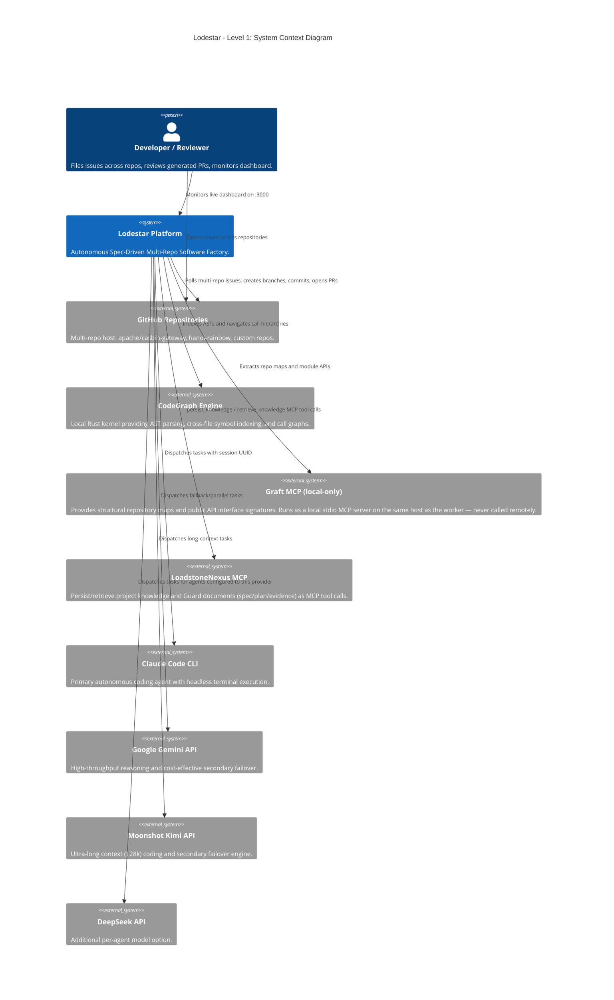
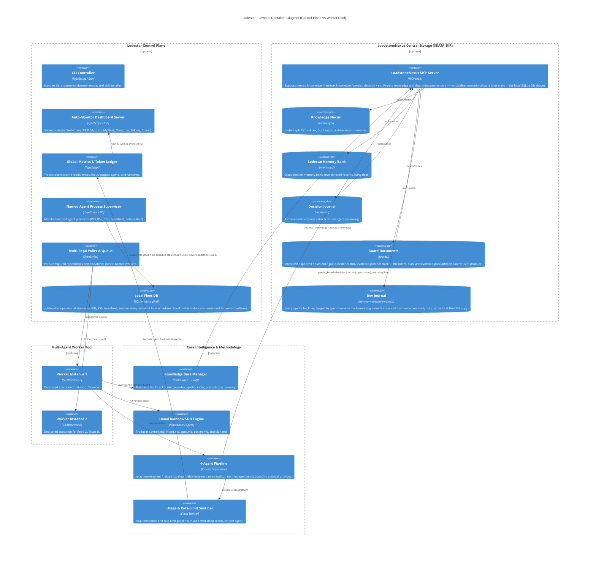
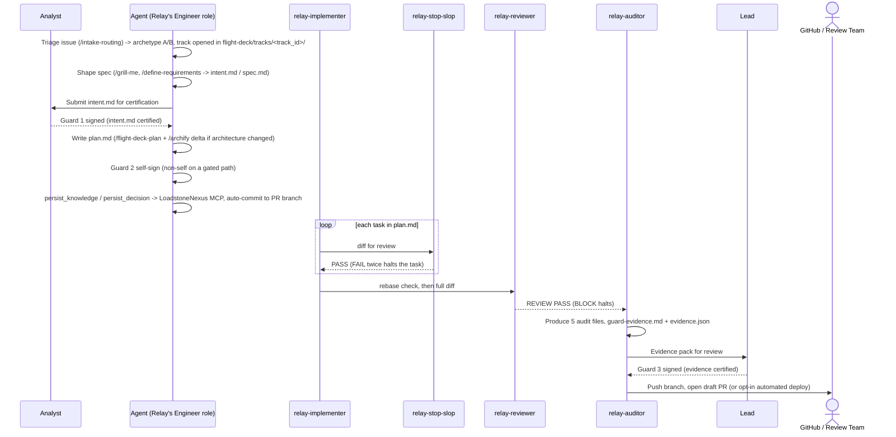
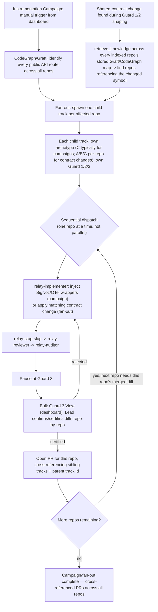

# Lodestar: Architectural Design Specification

> **Comprehensive Architectural Design applying Archy Principles, Modular Agentic Architecture & Multi-Agent Software Factory Patterns**
> Incorporating **Hanoi Rainbow** (Spec-Driven Development), **Relay** (Guard & Archetype Methodology), **MonoCode & Machinist** (Multi-Agent Process Factory & VM Harness), **CodeGraph & Graft** (Repository Knowledge Intelligence), **Multi-Model Adapters** (Claude, Gemini, Kimi, DeepSeek), **Token & Rate-Limit Sentinel**, and **Plugin System with Event Bus**.


---

## 1. Project Layout

```
src/
├── core/
│   ├── interfaces/
│   │   ├── agent-interface.ts     # Abstract agent lifecycle & execution contracts
│   │   ├── tool-interface.ts      # MCP and tool execution contracts
│   │   └── memory-interface.ts    # Knowledge & memory bank contracts
│   ├── engine.ts                  # Master finite state machine & orchestration
│   ├── registry.ts                # Dynamic component discovery & dependency injection
│   └── event-bus.ts               # Asynchronous event bus for telemetry & sentinels
├── services/
│   ├── agent-service/             # Multi-agent worker pool & named process supervisor
│   ├── memory-service/            # LoadstoneNexus, LodestarMemory, CodeGraph & Graft
│   ├── planning-service/          # Hanoi Rainbow SDD (spec, design, tasks engine)
│   ├── log-service/               # Log ingestion, PII scrubbing & exception deduplication
│   └── monitor-service/           # CI/CD verification & Slack/Discord gateway alerts
├── plugins/
│   ├── agents/
│   │   ├── watcher-agent.ts       # Log monitoring & issue triage agent
│   │   ├── reasoning-agent.ts     # Deep root-cause and issue analysis
│   │   ├── planning-agent.ts      # Spec and task breakdown agent
│   │   └── execution-agent.ts     # Code modification & test iteration agent
│   ├── tools/
│   │   ├── git-tool.ts            # Branching, commits, and diff inspection
│   │   ├── github-tool.ts         # Issue tracking, comments, PR creation
│   │   ├── sentry-tool.ts         # Log ingestion and trace fetcher
│   │   └── code-exec-tool.ts      # Test runner and build verification
│   └── memory/
│       ├── graph-memory.ts        # CodeGraph AST & cross-file call graphs
│       └── session-memory.ts      # LodestarMemory Bank & decision journal
├── adapters/
│   ├── anthropic-adapter.ts       # Claude Code CLI headless runner
│   ├── gemini-adapter.ts          # Google Gemini 2.5 Pro runner
│   ├── kimi-adapter.ts            # Moonshot Kimi (128k) runner
│   └── deepseek-adapter.ts        # DeepSeek runner
├── dashboard/                     # Lodestar live operations monitor (:3000)
└── config/                        # .env loader and system settings
```

Lodestar implements **true modularity** with a plugin system, service-oriented architecture, and loose coupling through abstract interfaces and event-driven communication.

### Core Architectural Design Principles

1. **Relay Architecture (Guard 1, Guard 2 & Guard 3 — adopted from [Relay](https://github.com/barantheva/relay)'s methodology)**:

   Lodestar adopts Relay's guard semantics verbatim (`RELAY_TEAM.md`, `RELAY.md`, `CLAUDE.md`, `AGENTS_RELAY.md`) rather than defining its own. Relay is a development methodology for small remote teams (3-6 people, async, multi-timezone) executed as a plugin with native skills and named sub-agents (`relay-implementer`, `relay-stop-slop`, `relay-reviewer`, `relay-auditor`). Work moves by baton: every stage leaves a file on disk in `flight-deck/tracks/<track_id>/`, and the file is what gets handed over. Lodestar plays Relay's **Engineer** role with an LLM agent instead of a person, on every track it handles.

   - **Six Stages**:
     1. **intake**: `/intake-routing` — routes work, assigns archetype, track ID, and owner.
     2. **shape**: `/grill-me` → `/define-requirements` → `/decompose-tasks` [Guard 1: `intent.md` — Analyst]. Also includes `/impact-assesment` (mandatory for multi-app/service changes), `/focus`, `/schema-model`, `/archify`, and `/prototype`.
     3. **plan**: `/flight-deck-plan` [Guard 2: `plan.md` (+ `/archify` delta) — Engineer].
     4. **build**: `relay-implementer` → `/tdd` → `/e2e-playwright` → `relay-stop-slop` (PASS required before advancing).
     5. **verify**: `relay-reviewer` (gated tracks) or `/pre-push-review`, `/sastanalysis`.
     6. **ship**: `relay-auditor` + `/verify-traceability` [Guard 3: evidence pack — Lead], with `/handoff` across all six.

   - **Three Guards**:
     - **Guard 1 (`intent.md` / PRD certification)**: A named human (**Analyst**) approves `intent.md` before any build starts. Agents never sign Guard 1. Requires `/impact-assesment` attached when a change spans multiple apps or services. Two rule-defined bypasses only: archetype **C** skips Guard 1 for a genuine reproducible bug fix with already-decided correct behaviour; archetype **H** skips Guard 1 by definition for a Sev-0/Sev-1 incident. Relay's own rule is that H is never agent-inferred — a human declares it. Lodestar follows that by default; **`ALLOW_AUTONOMOUS_INCIDENT_DECLARATION`** (opt-in, off by default — see below) is the one deliberate, documented deviation from it. Undeclared or disallowed, a candidate incident falls back to C (lightweight Guard 1) or A/B (full Guard 1).
     - **Guard 2 (`plan.md` plan approval)**: Applies only to archetypes A/B — C and H skip it, since `/relay-autopilot` collapses stages 3-6 into one unattended run for them. It is a **plan-quality check, not an independence check**, so whoever wrote `plan.md` may self-sign it. If the track introduces or alters architecture, an updated `/archify` diagram must be linked in `plan.md`. Since Lodestar's Engineer is always the LLM agent, **Guard 2 is always self-signed by the agent automatically** the moment `plan.md` is written — no human wait — *except* on a **gated path** (PII, auth, authorisation, audit logging), which forces a non-self (human) sign even on A/B. On self-sign, `plan.md` and the certification line auto-commit to the PR branch and auto-persist to LoadstoneNexus MCP (`persist_knowledge`/`persist_decision`) — both destinations, immediately, no approval.
     - **Guard 3 (evidence certification)**: A named human (**Lead**, independent of whoever built the track) signs the certification block in `guard-evidence.md` (mirrored machine-readably in `evidence.json`) after the 4-agent pipeline (`relay-implementer` → `relay-stop-slop` → `relay-reviewer` → `relay-auditor`) produces the evidence pack. **No bypass, on any archetype.** Evidence that changes after signing voids that signature — a re-run gets a fresh, unchecked block in both files, never a silent edit.

   - **Key Relay Operational Mechanics**:
     - **Bolt**: The execution period of one track: opens at `/intake-routing`, closes at the Guard 3 signature, or — when a repo has opted into auto-deploy — closes only once the deploy action completes (or reverts on failure).
     - **Deploy after Guard 3 (opt-in)**: A repo may let a signed Guard 3 trigger an automated production deploy, declared explicitly in `flight-deck/workflow.md` (`Deploy:` command + opt-in line). The agent reads `evidence.json`'s `guard3.status` before running it; a failed deploy reverts its own merge rather than leaving production half-applied. Off by default.
     - **Rebase check**: Before evidence is generated, `/relay-autopilot` compares the track's branch to the base it will merge into. A track open long enough for the base to move gets rebased first; an unresolvable conflict halts rather than generating evidence against a stale diff.
     - **Gated paths**: PII, auth, authorisation, audit logging force `relay-reviewer` (three layers: code review, `relay-stop-slop`, SAST) and forbid `relay-autopilot`, regardless of archetype.
     - **Code Style & Development Comment Rules**: Style defaults to the Google Style Guide per language (`flight-deck/code_styleguides/<lang>.md`) with `local-rules.md` override. Comments follow `comments.md`: WHY not WHAT, 4 canonical tags (`TODO (Agent):`, `WARNING:`, `PERF:`, `SECURITY:`), maximum 15 words and 2 lines, no author names or dates.
     - **Self-Improvement Loop**: `flight-deck/learnings.md` captures recurring guard findings, read by `relay-stop-slop` and `relay-reviewer` before scanning.

   **Team size mode — Lodestar's target audience is vibecoders: one person, or a small team, not necessarily Relay's reference 3-5.** Relay's independence rule (Guard 1 and Guard 3 signed by someone who didn't do the work) assumes there are enough people to enforce that separation. A solo vibecoder doesn't have a separate Analyst or Lead — so:
   - **`TEAM_MODE=solo`** (default for a single-person setup): the same person self-signs both Guard 1 and Guard 3. These stop being *independence* checks and become a **deliberate pause-and-review checkpoint** instead — the enforced act of stopping to actually look at the PRD/intent, and later the evidence pack, before either proceeds, rather than a rubber stamp that happens silently. This is a real relaxation of Relay's rule, not a reinterpretation of it — Relay itself requires a second person; solo mode is Lodestar's own addition for a scale Relay doesn't target.
   - **`TEAM_MODE=team`** (3-6 people, an Analyst and Lead configured — the human roles from `screen-list.md`'s dashboard, not agents): Relay's real separation rule applies untouched, exactly as `RELAY_TEAM.md` specifies. Nothing here changes for a team big enough to have one.
   - Guard 2 is unaffected either way — it was already a self-sign-by-whoever-wrote-the-plan check, which is what the agent does regardless of team size.
   - **SDD documents are required to exist, optional to read closely.** `intent.md`/`spec.md`/`design.md`/`plan.md` are always generated automatically in the background by the agent — a vibecoder is never expected to author a PRD by hand — and written in plain language a non-engineer can actually follow, not dense spec-speak. A solo Guard 1/Guard 3 sign is meant to be a skim, not a deep audit. Either way, every document is persisted to LoadstoneNexus MCP every time, so there's always a clear, readable project history to go back to later — even for a track that was skimmed and signed in ten seconds at the time.
   - **Autonomous incident declaration — opt-in, off by default.** `ALLOW_AUTONOMOUS_INCIDENT_DECLARATION=false` by default: matches Relay's rule exactly, a human always declares Sev-0/Sev-1 before archetype H's Guard-1 bypass applies. Set it `true` and Lodestar's own monitoring (a SigNoz latency spike, a Sentry exception spike past a configured threshold) may declare the incident itself and assign archetype H without waiting for a human — useful for a solo vibecoder who isn't awake to click "declare," at the cost of the one check that stops a false-positive monitoring signal from triggering an unattended autopilot fix against production. This is the single configurable relaxation of a Relay safety rule in the whole system — everything else in Guard 1/2/3 (§ above, § job types below) stays exactly as Relay specifies it.
   - **Guard 1 and Guard 3 are structural, not configurable off.** `TEAM_MODE` changes *who* signs them; `ALLOW_AUTONOMOUS_INCIDENT_DECLARATION` changes *whether Guard 1 can be reached autonomously for H*. Neither setting, nor any other, removes Guard 1 or Guard 3 from the pipeline — every track still passes through both, on every archetype, always.

   **Lodestar job type → Relay archetype**:

   | Lodestar job type | Archetype | Guard 1 | Guard 2 |
   | :--- | :--- | :--- | :--- |
   | Issue Monitor | Triaged per-issue: **A** (new/ambiguous), **B** (brownfield, partial ACs), or **C** (complete ACs, bounded diff) | Full (A/B) or lightweight (C) | Agent self-signs (A/B only; skipped for C) |
   | Incident Monitor | **H** once declared — by a human (default), or autonomously if `ALLOW_AUTONOMOUS_INCIDENT_DECLARATION=true`; otherwise falls back to C/A/B | Skipped (H) once declared; otherwise per above | Skipped (H, autopilot) |
   | Codebase Monitor | **C** (bounded diff, known regression), occasionally A/B if the finding needs shaping | Lightweight, or skipped for a genuine bug-fix diff | Skipped (autopilot) |
   | Instrumentation Campaign | **C** (Adding cross-repo monitoring to identified APIs via SigNoz/OTel wrappers) | Lightweight (Automated API discovery scan across repos) | Skipped (autopilot) |

   All four job types pass through **Guard 3 always**, and a **gated path** (PII/auth/authz/audit-logging) forces `relay-reviewer` and forbids autopilot regardless of job type or archetype.

2. **Plugin-Based Architecture**: Agents, tools, and memory stores implement strict interface contracts and register dynamically with the `ServiceRegistry`.
3. **Interface Segregation**: Clean separation between agent execution (`agent-interface.ts`), tool invocation (`tool-interface.ts`), and persistent recall (`memory-interface.ts`).
4. **Dependency Injection**: Services receive adapters and memory stores at runtime, allowing zero-friction model swapping (Claude ↔ Gemini ↔ Kimi ↔ DeepSeek).
5. **Event-Driven Communication**: All lifecycle events (job started, task finished, rate-limit hit, quota refreshed, PR created) stream through the asynchronous `EventBus`.
6. **Hot-Swappable Components**: Adapters and plugins can be updated, enabled, or reloaded without restarting the background daemon.

---

## 2. Archy Architectural Principles Applied

Lodestar's architecture adheres to strict architectural sensors and modularity principles:

1. **Control Plane vs. Worker Plane Separation (Machinist Pattern)**:
   - **Control Plane**: Manages configuration, multi-repository issue queues, live dashboard UI (:3000), token accounting, and health checks.
   - **Worker Plane**: Spawns isolated coding agent processes in independent Git worktrees, capturing stdout/stderr streams without blocking the control plane.
2. **Worktree & Branch Isolation**:
   - Every track is executed within an isolated Git worktree (`.worktrees/<track_id>/`, Relay's own convention). Concurrent agents never interfere with each other or the default branch.
3. **Design Structure Matrix (DSM) & Dependency Inversion**:
   - High-level orchestrators depend only on abstract interfaces (`BaseProvider`, `KnowledgeManager`). Concrete models (Claude, Gemini, Kimi, DeepSeek, OpenAI) are pluggable adapters.
4. **Idempotence & Persistent State**:
   - Session states, UUIDs, and task checklists (`plan.md`) are persisted on disk. If the VM reboots or a rate limit occurs, execution resumes from the exact state.
5. **Sensor Observability**:
   - Output streams are inspected in real time by the Sentinel to detect rate limits and token exhaustion prior to API failure.

---

## 3. C4 Architecture Specification

### Level 1: System Context Diagram (Multi-Repo & Multi-Agent)



> **Why MCP instead of direct filesystem access to `$DATA_DIR`**: Graft is exposed as a local MCP server rather than a reimplemented-in-repo library. Putting LoadstoneNexus behind the same MCP boundary means any MCP-capable agent (not just Lodestar's own worker code) can persist/retrieve project knowledge and Guard documents with one `retrieve_knowledge`/`persist_knowledge` contract, instead of every service (dashboard, orchestrator, fleet supervisor) reading and writing `$DATA_DIR` files directly.
>
> **Knowledge backend is pluggable, chosen by config, not hardcoded to LoadstoneNexus**: `memory-service/` implements `core/interfaces/memory-interface.ts` against whichever backend `KNOWLEDGE_BACKEND` names — **`loadstonenexus`** (default) or **`obsidian`**, storing the same project knowledge/decisions/Guard documents as notes in an Obsidian vault (`OBSIDIAN_VAULT_PATH`) via its Local REST API plugin (Obsidian has no MCP server of its own; a thin bridge wraps that HTTP API in the same `persist_knowledge`/`retrieve_knowledge`/`persist_decision`/`persist_guard_document`/`retrieve_guard_document` contract). No caller special-cases either backend — planning-service, the dashboard, and the dev-journal writer all go through the interface, never a backend-specific client, so switching `KNOWLEDGE_BACKEND` is a config change, not a code change. Same "markdown files are the source of truth" principle (`plan.md` §3), applied to a second, GUI-browsable backend rather than a competing one.
>
> **Graft stays local-only — token optimization**: unlike LoadstoneNexus MCP (small persist/retrieve calls, fine to be remote/shared), Graft's job is generating large repo maps and API signatures straight from the checked-out worktree. Calling a remote Graft over the network would mean serializing that whole map through an extra hop — and, worse, tempts routing it through model context instead of a local tool call. Graft runs as a **local stdio MCP server on the same host as the worker**: the worker queries it directly and only the distilled answer (a few symbols, a call path) enters the LLM's context, not the full repo map.

---

### Level 2: Container Diagram (Control Plane & Worker Pool)



> **Local SQLite vs. LoadstoneNexus MCP — what goes where**: job-related operational bookkeeping (PID, RSS, heartbeat, session state, rate-limit hold schedules — §6 point 5) always stays in the **local SQLite DB**, per instance, and is never sent to LoadstoneNexus. Only **project knowledge** (CodeGraph/Graft summaries, memories, decisions), **Guard documents** (`intent.md`, `spec.md`, `plan.md`, `guard-evidence.md`, `evidence.json`), and each agent's **dev-journal** (every log line, tagged by agent name) are passed to LoadstoneNexus MCP. The distinction: LoadstoneNexus holds what a human or another agent might need to read back later — including "what did agent-casbin-alpha actually do" — while the local DB holds what only this instance's supervisor needs to keep a job running.

---

### Level 3: Sequence & Lifecycle Diagrams (Relay Architecture: Guard 1, Guard 2 & Guard 3)

**Issue Monitor, archetype A/B — full cycle, all three guards:**



**Incident Monitor (H, once human-declared) / Codebase Monitor (C) — bounded diff, autopilot:**

```mermaid
sequenceDiagram
    participant Trigger as SigNoz/Sentry/CloudWatch anomaly (human-declared for H) or commit-diff finding (C)
    participant Eng as Agent (Relay's Engineer role)
    participant Auto as Autopilot (implementer + stop-slop + reviewer + auditor, unattended)
    participant Lead
    actor GitHub as GitHub / Review Team

    Trigger->>Eng: Triage (/intake-routing) -> archetype C or H
    Note over Eng: Guard 1 skipped — reproducible bug fix (C)<br/>or human-declared incident (H, RCA owed after)
    Eng->>Auto: Run /relay-autopilot
    Note over Auto: Guard 2 skipped for C/H
    Auto->>Auto: plan -> build -> verify -> ship, unattended
    Note over Auto: a gated path (PII/auth/etc.) forces relay-reviewer<br/>and non-self Guard 2 sign, forbidding autopilot
    Auto->>Lead: Evidence pack (guard-evidence.md + evidence.json), halt
    Lead-->>Auto: Guard 3 signed
    Auto->>GitHub: Push branch; new PR (Incident) or update existing PR (Codebase)
```

---

## 4. Design Structure Matrix (DSM)

| Subsystem | 1. Config | 2. Metrics & Dashboard | 3. Knowledge Base | 4. Rainbow SDD | 5. Auto-Coders | 6. Sentinel | 7. Multi-Repo Gateway | 8. Orchestrator |
| :--- | :---: | :---: | :---: | :---: | :---: | :---: | :---: | :---: |
| **1. Config** | — |  |  |  |  |  |  |  |
| **2. Metrics & Dashboard** | X | — |  |  |  |  |  |  |
| **3. Knowledge Base** | X |  | — |  |  |  |  |  |
| **4. Rainbow SDD** | X |  | X | — |  |  |  |  |
| **5. Auto-Coders** | X | X |  |  | — | X |  |  |
| **6. Sentinel** | X | X |  |  |  | — |  |  |
| **7. Multi-Repo Gateway** | X |  |  |  |  |  | — |  |
| **8. Orchestrator** | X | X | X | X | X | X | X | — |

*Clean downward dependency flow with zero circular imports.*

---

## 5. Universal Agent Skill Integration (`skill install`)

Lodestar is distributed as a standard **Agent Skill**:
- Canonical source: `skills/lodestar/SKILL.md` (`.agents/skills/lodestar/SKILL.md` is a symlink to it, so both locations always match)
- Can be installed globally into `~/.gemini/config/skills/lodestar/` or `~/.claude/skills/lodestar/`
- Enables any AI agent (Claude Code, Antigravity, Cursor, Codex, OpenCode, MonoCode, Machinist) to invoke the CLI commands documented in the SKILL.md (`run`, `daemon`, `dashboard`, `init-knowledge`, `sentinel-test`, `status`).

---

## 6. Named Agent Process Supervision & Fleet Architecture

1. **Named Worker Assignment**:
   - Each worker runs under a distinct moniker (e.g. `--name agent-casbin-alpha` or auto-assigned `worker-1`).
   - The supervisor registers the agent in the **local Fleet DB** (SQLite, `bun:sqlite`) — job/worker operational state is instance-local and never sent to LoadstoneNexus.
2. **Real-Time Process Sensor**:
   - Monitors (all rows live in the local Fleet DB, not LoadstoneNexus):
     - `PID`: Operating system process identifier.
     - `RSS / Memory`: Resident Set Size in MB to prevent out-of-memory crashes during heavy AST parsing.
     - `CPU %`: Active execution percentage.
     - `Heartbeat`: Periodic health pulse (every 5 seconds).
     - `Assigned Worktree`: Target repository and branch being modified.
     - `Session State`: `idle`, `running`, `paused_rate_limited`, `restarting`, `crashed`.
3. **Auto-Recovery & Self-Healing**:
   - If a named worker process exits abnormally, the supervisor automatically respawns the worker using the saved session state read from the **local Fleet DB**, resuming the in-flight task checklist. (The task checklist's *content* — `plan.md` — is itself a Guard document that lives in LoadstoneNexus; only the "which task was in flight" bookkeeping is local.)
4. **Lodestar Fleet UI**:
   - Accessible on the dashboard under **"My fleet"** with an `All agents` selector, showing live health, memory footprint, active issue, and real-time logs per named agent.
5. **Token/rate-limit hold-and-resume, per agent** — every agent watches its own quota independently, not one global sentinel:
   - A rate-limited job writes a **hold schedule** to the **local Fleet DB** (job/track id, provider, model, `resume_at` timestamp — job-related bookkeeping, not project knowledge, so it stays local, never LoadstoneNexus) and its Session State flips to `paused_rate_limited`. The supervisor (or a lightweight poller independent of any one worker process) periodically checks the local DB for jobs whose `resume_at` has passed and auto-triggers them — surviving a worker restart, not just surviving within one. This applies uniformly to **every** agent role: each of the 4 pipeline agents (`relay-implementer`, `relay-stop-slop`, `relay-reviewer`, `relay-auditor`) can be bound to a different provider (§7) and independently hits, holds on, and resumes from its own quota — one agent's rate limit never blocks another's.
   - **Unknown reset time**: if the provider gives no explicit reset timestamp at all, default `resume_at` to **now + 6 hours** and re-check on that cadence rather than polling tightly or guessing a shorter window.
6. **Worktree lifecycle & cleanup** — disk on a single EC2 instance is finite, and every track checks out a full copy of the target repo:
   - A worker checks out `.worktrees/<track_id>/` when the track opens, commits and pushes its branch as it works, and Guard 3 opens (or updates) the PR from that pushed branch.
   - Once Guard 3 **certifies** (PR opened/updated or auto-deployed) — not on a Guard 3 rejection, which loops back to `relay-implementer` and still needs the working tree — the worker **deletes `.worktrees/<track_id>/`**. The durable record is the pushed branch on GitHub plus the Guard documents in LoadstoneNexus; the local checkout was only ever a workspace, disposable once its content has reached both.
   - This is what keeps the instance from running out of disk as tracks accumulate — without it, a long-running fleet would retain a full repo checkout per track forever.

**Unified Observability (Traces, Metrics, Logs)**: once workers run across multiple machines (not just multiple local processes), correlating a task across Guard 1 → worker → Guard 3 hops uses OpenTelemetry + **SigNoz** for viewing traces, logs, and metrics. SigNoz provides a single unified platform and its core is MIT-licensed. Deferred until the fleet is actually multi-machine. Configuration (`OTEL_EXPORTER_OTLP_ENDPOINT`, sampling rate, SigNoz UI port) is in `deployment.md` §7.

**Considered and deferred: [measure-sh](https://github.com/measure-sh/measure) for crash/session-replay ingestion.** Apache-2.0, no license issue, but it's a **mobile-only** platform (Android/iOS/Flutter/React Native crash+ANR+session-replay) — Lodestar's repos are backend/web services with no mobile client, so it has nothing to monitor. Revisit as a Guard 1 ingestion source only if a mobile-client repo joins the fleet; don't wire it in speculatively. Configuration (`MEASURE_ENDPOINT`, `MEASURE_API_KEY`, `MEASURE_APP_ID`) is in `deployment.md` §7 — left unset until then.

---

## 7. Agent Configuration: Count, Model, Job Assignment

Fleet size and per-agent behavior are deployment-time config:

1. **Agent count is configurable** — how many named workers the fleet supervisor runs is a deployment setting (e.g. `AGENT_COUNT=3` in `.env`, or one row per worker in the local Fleet DB, §6), not a hardcoded number.
2. **Each agent's model access is configured independently** — one agent can run on Claude, another on **DeepSeek**, another on Gemini, Kimi, or OpenAI. This is a per-agent override of the global `PRIMARY_AUTO_CODER`/`FALLBACK_AUTO_CODERS` config, e.g. `AGENT_1_PROVIDER=claude`, `AGENT_2_PROVIDER=deepseek`, `AGENT_3_PROVIDER=openai`.
3. **Each agent's job is assignable from the dashboard UI**, not just `.env` — the My Fleet screen (`screen-list.md` §3) has a job-assignment control per worker row, so a human can reassign what an agent monitors without redeploying. Job types are defined in §8 below.

---

## 8. Agent Job Types & Workflow Variants

Four job types an agent can be assigned to, each routed through Relay's archetype/guard rules (§1 principle 1 table). **Guard 2, whenever it applies, is always self-signed by the agent automatically** — the LLM agent is Relay's Engineer here, and Relay lets whoever wrote `plan.md` self-sign it — so it never waits on a human *except* on a gated path (PII/auth/authz/audit-logging), which forces a non-self sign regardless of job type. On self-sign, `plan.md` and the certification line auto-commit to the PR branch and auto-persist to LoadstoneNexus MCP, immediately, no approval. Guard 1 and Guard 3 are the two guards that can involve a human, and exactly how depends on which archetype the work triaged into.

| Job Type | Trigger | Archetype | Guard 1 | Guard 2 | Guard 3 output | Guard 3 (always human, no bypass) |
| :--- | :--- | :--- | :--- | :--- | :--- | :---: |
| **App / Log & Incident Monitor** | Sentry / CloudWatch / SigNoz trace anomaly | **H** once declared — by a human (default), or autonomously if `ALLOW_AUTONOMOUS_INCIDENT_DECLARATION=true` (§1); otherwise falls back to C/A/B like any other finding | Skipped once declared H; full/lightweight otherwise | Skipped (autopilot) | **New** draft PR + evidence pack; RCA owed after, per Relay's H rule | Yes — Lead certifies |
| **Issue Monitor** | GitHub issue matching `ISSUE_LABEL_FILTER` | Triaged per-issue: A (new/ambiguous), B (brownfield/partial ACs), or C (complete ACs, bounded diff) | Full (A/B, Analyst signs) or lightweight (C) | Agent self-signs (A/B only; skipped for C) | **New** draft PR + evidence pack | Yes — Lead certifies |
| **Codebase Monitor** | Any commit/deploy to a watched repo; re-runs the full knowledge index (CodeGraph/Graft) and triages any finding (regression, contract break, vuln) | **C** typically (bounded diff); A/B if the finding needs shaping | Lightweight, or skipped for a genuine bug-fix diff | Skipped (autopilot) | **Updates the existing/related PR** instead of opening a new one, + evidence pack | Yes — Lead certifies |
| **Instrumentation Campaign** | Manual trigger from UI to add cross-repo monitoring to all APIs | **C** (bounded diff to inject OTel wrappers) | Lightweight (Automated discovery of API endpoints) | Skipped (autopilot) | **Bulk Guard 3 View**; New draft PRs + evidence pack per repo | Yes — Lead certifies each repo |

The only two things that can ever wait on a human across all four job types: Guard 1 (an Analyst, for A/B/undeclared-incident work — with two rule-defined bypasses, C's bug-fix carve-out and H's declared-incident carve-out) and Guard 3 (a Lead, always, no bypass). Guard 2 runs unattended in every case that reaches it.

---

## 9. Cross-Repo Fan-Out & Instrumentation Campaigns

### Level 4: Cross-Repo Fan-Out & Instrumentation Campaign Flow



> Why sequential, not parallel: a downstream repo's fix may need to reference the upstream repo's real, merged diff (the actual new function signature, not just its planned one) — and a single instance has a bounded worker pool (§6, §7) regardless. See the two Discovery/Delivery breakdowns below for the full per-mode detail.

A single track sometimes can't be fixed inside one repo — a shared API contract change, for example, needs a matching update in every repo that consumes it. Similarly, **Instrumentation Campaigns** (e.g. injecting OpenTelemetry tracing wrappers across all APIs) need to affect every repository at once.

This is why **all project knowledge (CodeGraph/Graft summaries per repo) is persisted to LoadstoneNexus MCP**, not kept purely local to each worker: it's the only place a cross-repo lookup can happen, since Graft itself stays local-only and per-repo (§3's token-optimization rule) and never queries another repo's checkout directly.

For an **Instrumentation Campaign**:
1. **Discovery**: The agent uses CodeGraph/Graft to scan the AST of every repository and identify all public API routes (e.g., Express routes, Spring Boot controllers).
2. **Fan-Out**: The agent spawns a child track for each repository.
3. **Modification**: `relay-implementer` injects the necessary SigNoz/OpenTelemetry span wrappers into each identified API.
4. **Bulk Certification**: The agent pauses at Guard 3. It presents a Bulk Guard 3 View in the dashboard, allowing the Lead to confirm and certify the diffs repository-by-repository before opening the final PRs.

For a **General Cross-Repo Contract Change**:
1. **Discovery**: during Guard 1 shaping or Guard 2 planning, if the fix touches a symbol/contract other repos depend on, the worker calls LoadstoneNexus MCP's `retrieve_knowledge` across **every indexed repo's stored Graft/CodeGraph map** (not a live Graft call to another repo) to find which repos reference it.
2. **Fan-out**: one **child track per affected repo**, each independently triaged into its own archetype (a repo with complete ACs for its half of the change might be C; another might need full A/B shaping) and routed through its own Guard 1/2/3 — a cross-repo change is not a single track that touches multiple repos, it's a parent change that spawns several ordinary single-repo tracks.
3. **Sequencing — one repo at a time, not parallel**: later repos in the fan-out are processed only after the earlier ones have actually pushed their change, because a downstream repo's fix may need to reference the upstream repo's real, merged diff (the actual new function signature, not just its planned one) — and because a single instance has a bounded worker pool (§6, §7) to begin with.
4. **Delivery**: each repo gets its **own PR**, cross-referencing the sibling tracks/PRs for traceability (e.g., "Related: `org/repo-b#123`, part of cross-repo change `<parent-track-id>`"). Each child track's worktree is cleaned up independently per §6 point 6 once its own Guard 3 certifies.

---

## 10. Release Tracking & Tagging

A release is a repo-level ops action — cutting a tag from the current default-branch HEAD and publishing its changelog — not a Relay track. It bundles work that already went through Guard 1/2/3 individually; it doesn't re-certify anything and isn't gated by another Guard of its own.

**Naming convention (fixed, not configurable)**:
- **Tag**: `dd-mm-yyyy-<short commit hash>` — today's date plus the last 7 characters of the target repo's HEAD SHA at the moment of creation (e.g. `07-09-2026-a1b2c3d`). Deterministic from repo + commit + day; never a manually typed semantic version.
- **Changelog file**: `change-log-<same tag>.md`, committed to that repo's `changelogs/` directory in the same commit the tag points at.

**Flow**:
1. Pick a repo (dashboard's Create Release screen, `screen-list.md` §7c, or CLI).
2. Compute the tag/filename from today's date + HEAD's short SHA — read-only, recomputed live if the repo selection changes.
3. Draft the changelog by querying Run History's resolved tracks for that repo since its last tag (grouped by job type, same as `screen-list.md` §7's tabs), editable before creating.
4. On confirm: `git-tool.ts` creates the annotated tag and commits the changelog file in one commit, pushes both, and the monitor-service dispatches the usual gateway notification (Slack/Discord/WhatsApp/Email) — the same delivery path as any other run outcome (§6).
5. The Release Tracker screen (`screen-list.md` §7b) reads tag/changelog history from GitHub the same way the Knowledge screen caches Graft/CodeGraph output (§3) — a local snapshot refreshed on each release, not re-fetched per page view.

**Module placement**: no new top-level service. Tag/commit operations extend `plugins/tools/git-tool.ts` (it already owns branching/commits/diff); changelog drafting reads from the same source Run History renders from (LoadstoneNexus `retrieve_knowledge`, filtered by repo since the last tag) — no separate release-service or new persistent store.
