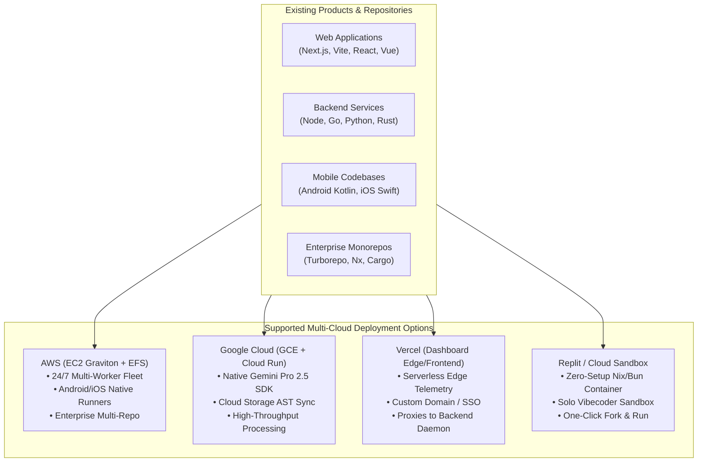
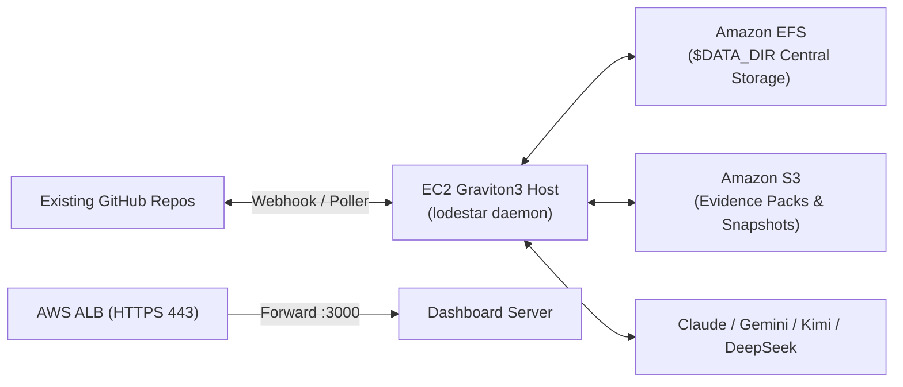
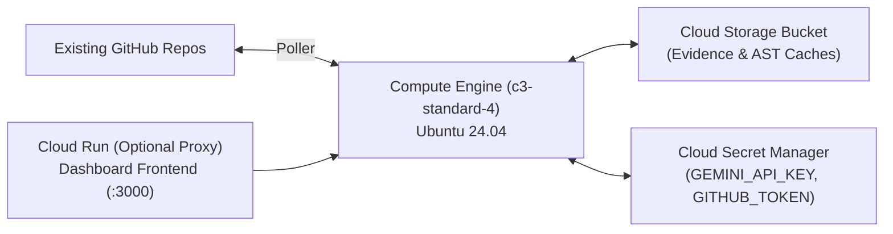
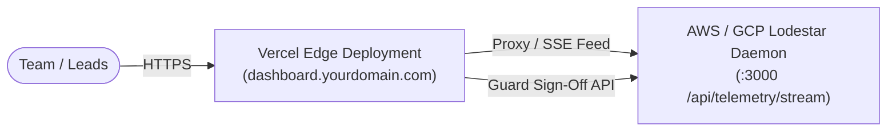
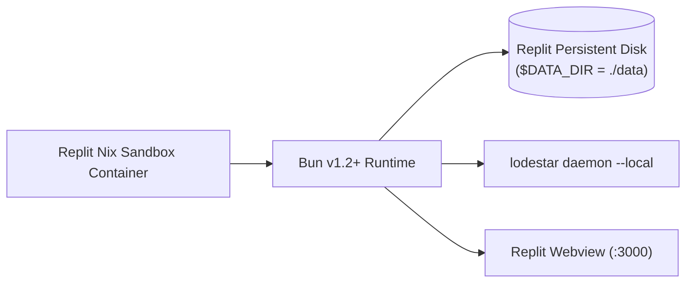
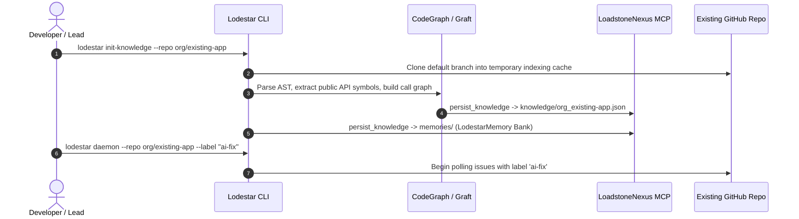
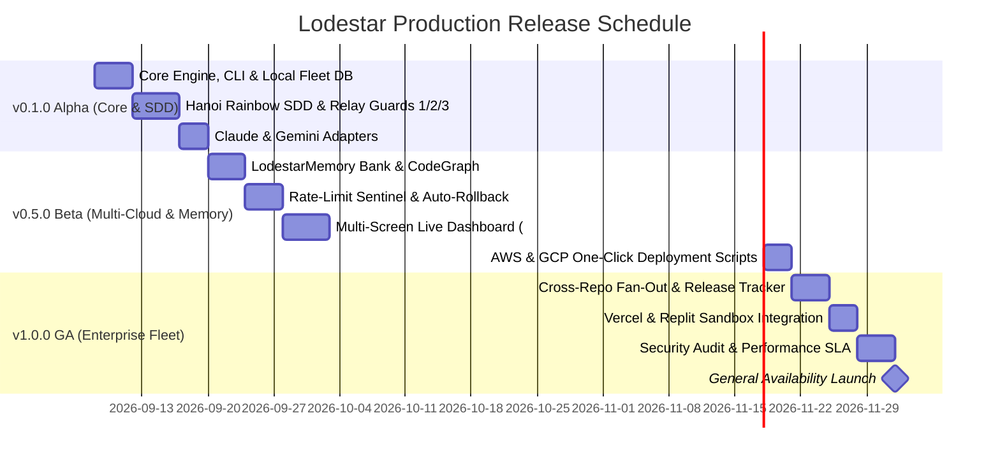

> **Archived**: superseded by the actual deployment decision. `architecture.md`/`plan.md`/`deployment.md` commit to a single AWS EC2 instance under systemd — the GCP/Vercel/Replit topologies and Terraform setup below were never built and aren't planned; treat them as abandoned exploration, not a roadmap. `deployment.md` is the current source of truth for deployment.

# Lodestar: Multi-Platform Release Plan & Cloud Onboarding Guide

> **Production Release Roadmap, Multi-Cloud Deployment Topologies (AWS, Google Cloud, Vercel, Replit), Existing Product Onboarding Workflows, and Automated Release Lifecycle.**

---

## 1. Multi-Platform Cloud Deployment Topologies for Existing Products

Lodestar seamlessly connects with existing products (Web apps, Microservices, Android/iOS apps, Monorepos) across four flexible deployment tiers:



---

### 1.1 AWS Deployment (Enterprise Multi-Repo Fleet & Mobile)

Best for 24/7 background daemons, massive monorepos, and teams managing multiple repositories with continuous monitoring.



- **Core Components**:
  - **EC2 `t4g.xlarge` / `c7g.2xlarge`**: Hosts the `lodestar daemon`, Local Fleet DB (SQLite), and isolated Git worktrees (`.worktrees/<track_id>/`).
  - **Amazon EFS mounted at `/opt/LoadstoneNexus`**: Provides persistent central storage for `LodestarMemory Bank`, AST index caches, and Hanoi SDD Guard documents.
  - **Application Load Balancer (ALB) + ACM TLS**: Exposes the live operations dashboard (:3000) over secure HTTPS.
  - **AWS Systems Manager (SSM)**: Zero-bastion SSH-less management.
- **Setup Command**:
  ```bash
  cd deploy/terraform
  terraform init && terraform apply
  ```

---

### 1.2 Google Cloud (GCP) Deployment (Gemini-Optimized & Scalable Compute)

Ideal for teams deeply leveraging Google Gemini 2.5 Pro, Google Cloud Storage, and Cloud Build CI pipelines.



- **Core Components**:
  - **Compute Engine `c3-standard-4` (or `e2-standard-4`)**: Runs the daemon, CodeGraph AST engine, and supervisor.
  - **Google Cloud Storage (GCS)**: Mounted via `gcsfuse` or synced for persistent `$DATA_DIR` artifacts and Evidence Packs.
  - **Cloud Secret Manager**: Stores `GEMINI_API_KEY`, `ANTHROPIC_API_KEY`, `KIMI_API_KEY`, `DEEPSEEK_API_KEY`, and `GITHUB_TOKEN`.
- **One-Line GCP VM Provisioning**:
  ```bash
  gcloud compute instances create lodestar-host \
      --zone=us-central1-a \
      --machine-type=c3-standard-4 \
      --image-family=ubuntu-2404-lts-amd64 \
      --image-project=ubuntu-os-cloud \
      --boot-disk-size=100GB \
      --boot-disk-type=pd-ssd \
      --scopes=cloud-platform \
      --metadata=startup-script='curl -fsSL https://raw.githubusercontent.com/<your-fork>/Lodestar/main/deploy/setup-vm.sh | sudo bash'
  ```

---

### 1.3 Vercel Deployment (Serverless Edge Dashboard & UI Ingress)

Ideal for providing instant, serverless web access to the **Lodestar Live Operations Dashboard** on a custom domain with team SSO, while pointing to an AWS or GCP backend daemon.



- **Architecture**:
  - The static dashboard assets (`src/dashboard/views/`, `src/dashboard/public/`) deploy as a Next.js / Edge static site.
  - API requests (`/api/guards/sign`, `/api/fleet/reassign`, `/api/telemetry/stream`) rewrite to the backend daemon IP/domain via `vercel.json`:
- **`vercel.json` Configuration**:
  ```json
  {
    "version": 2,
    "rewrites": [
      {
        "source": "/api/:path*",
        "destination": "https://lodestar-backend.yourdomain.com/api/:path*"
      },
      {
        "source": "/(.*)",
        "destination": "/index.html"
      }
    ]
  }
  ```
- **Deploy Command**:
  ```bash
  cd src/dashboard
  vercel --prod
  ```

---

### 1.4 Replit Deployment (Zero-Setup Cloud IDE for Solo Vibecoders)

Perfect for individual developers and solo vibecoders wanting an instant, zero-cost sandbox with zero local setup.



- **Configuration (`.replit` & `replit.nix`)**:
  ```toml
  # .replit
  run = "bun run src/cli/index.ts daemon --dashboard"
  entrypoint = "src/cli/index.ts"

  [nix]
  channel = "stable-24_05"

  [ports]
  localPort = 3000
  externalPort = 80
  ```
- **One-Click Launch**:
  1. Click **Import from GitHub** in Replit and enter your `Lodestar` repository URL.
  2. Set Secrets in the Replit Secrets tool (`GITHUB_TOKEN`, `ANTHROPIC_API_KEY`, `GEMINI_API_KEY`).
  3. Hit **Run** $\rightarrow$ Replit automatically boots the daemon and opens the live dashboard on port 3000 in the internal webview!

---

## 2. Onboarding Existing Products to Lodestar

Connecting an existing codebase (monorepo, web app, or mobile app) requires zero invasive changes to your production source code:



### Step-by-Step Existing Product Onboarding Runbook

1. **Step 1: Configure Environment Variables in `.env`**:
   ```env
   # Add your existing repository
   GITHUB_REPO=my-org/my-existing-product,my-org/auth-service
   ISSUE_LABEL_FILTER=lodestar,bug,enhancement

   # Select Knowledge Backend
   DATA_DIR=/opt/LoadstoneNexus
   KNOWLEDGE_BACKEND=loadstonenexus

   # Configure Multi-Model Providers
   PRIMARY_AUTO_CODER=claude
   FALLBACK_AUTO_CODERS=gemini,kimi,deepseek
   ```

2. **Step 2: Initialize Knowledge & Memory Banks**:
   ```bash
   # Index cross-file ASTs and symbol maps for the existing product
   bun run src/cli/index.ts init-knowledge --repo my-org/my-existing-product
   ```

3. **Step 3: Define Test/Build Workflow (Optional in `flight-deck/workflow.md`)**:
   Create `flight-deck/workflow.md` in the target repository to specify verification commands:
   ```markdown
   # Workflow Specification
   Test: bun test
   Build: bun run build
   Lint: bun run lint
   Deploy: ./deploy/prod.sh  # Opt-in deploy after Guard 3
   ```

4. **Step 4: Launch Daemon**:
   ```bash
   bun run src/cli/index.ts daemon --dashboard
   ```

---

## 3. Lodestar Versioned Release Plan



### Release Milestones & Feature Scope

#### **Milestone 1: v0.1.0 Alpha — Core SDD & Relay Guard Foundation**
- **Scope**:
  - Master FSM Engine (`src/core/engine.ts`) with async `EventBus`.
  - Hanoi Rainbow SDD generator producing `intent.md`, `spec.md`, `design.md`, `plan.md`.
  - Relay Guard 1 (Analyst PRD certification), Guard 2 (Engineer plan self-sign), and Guard 3 (Lead evidence pack certification).
  - CLI commands: `run`, `status`, `sentinel-test`.
- **Target Date**: End of Week 1.

#### **Milestone 2: v0.5.0 Beta — Memory, Multi-Model & Live Dashboard**
- **Scope**:
  - `LodestarMemory Bank` with LoadstoneNexus MCP storage (`$DATA_DIR`).
  - Multi-model adapter suite: **Claude Code CLI**, **Gemini 2.5 Pro**, **Moonshot Kimi 128k**, **DeepSeek**.
  - Rate-Limit Sentinel with persistent SQLite hold schedules.
  - 13-screen responsive Web Dashboard on port `:3000` matching `mock-ui.html`.
  - AWS Graviton (`t4g.xlarge`) and GCP Terraform modules.
- **Target Date**: End of Week 3.

#### **Milestone 3: v1.0.0 GA — Enterprise Multi-Repo Factory & Cloud GA**
- **Scope**:
  - Automated cross-repo AST API discovery and sequential child track fan-out.
  - Release Tagging (`dd-mm-yyyy-<SHA>`) with automated `changelogs/change-log-<tag>.md` commits.
  - Vercel Edge Dashboard and Replit one-click sandbox integrations.
  - 30-minute post-deploy auto-rollback engine with Slack/Discord alert gateways.
- **Target Date**: End of Week 5.

---

## 4. Automated Release Tagging & Changelog Specification

Lodestar enforces a deterministic, immutable release standard for every managed repository:

1. **Tag Naming Convention**:
   $$\text{Tag} = \text{DD-MM-YYYY}-\langle\text{short HEAD SHA}\rangle \quad (\text{e.g., } \texttt{07-09-2026-a1b2c3d})$$
2. **Changelog Artifact**:
   - Location: `changelogs/change-log-<tag>.md`.
   - Content: Grouped by Relay Archetype (Sev-0/1 Incidents [H], Features [A], Enhancements [B], Bug Fixes [C], Instrumentation Campaigns).
   - Includes cross-links to Guard 3 certified evidence packs and merged PRs.
3. **Release Execution Flow**:
   ```bash
   # Execute release cutting from CLI or Dashboard UI
   bun run src/cli/index.ts release --repo my-org/existing-app
   ```

---

## 5. Rollback & Disaster Recovery SLA

| Failure Scenario | Automated Recovery Action | Recovery Time Objective (RTO) | Recovery Point Objective (RPO) |
|---|---|---|---|
| **Worker Process Crash** | Named supervisor respawns worker process; resumes track from saved SQLite session state. | $< 5\text{ seconds}$ | $0\text{ seconds}$ (State in SQLite) |
| **VM Hypervisor Failure** | AWS CloudWatch `recover` alarm automatically reboots instance on fresh physical host. | $< 3\text{ minutes}$ | $0\text{ seconds}$ (EBS attached) |
| **Production Deploy Regression** | Monitor service detects $3\times$ probe failure; executes `git revert -m 1 HEAD` and triggers alert. | $< 2\text{ minutes}$ | N/A (Immediate Revert) |
| **API Rate-Limit Lockout** | Sentinel writes hold schedule to SQLite; pauses worker and auto-resumes when quota refreshes. | Exact reset window (or $+6\text{h}$) | $0\text{ seconds}$ (Zero lost progress) |
| **Data Corruption in `$DATA_DIR`** | Restore `LodestarMemory` and AST indices from daily S3 snapshot backup. | $< 10\text{ minutes}$ | $\le 24\text{ hours}$ |
