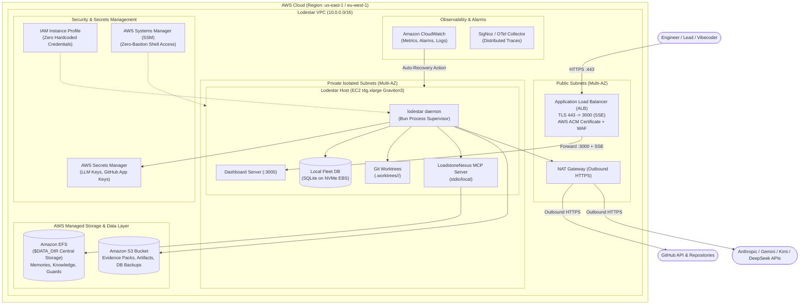
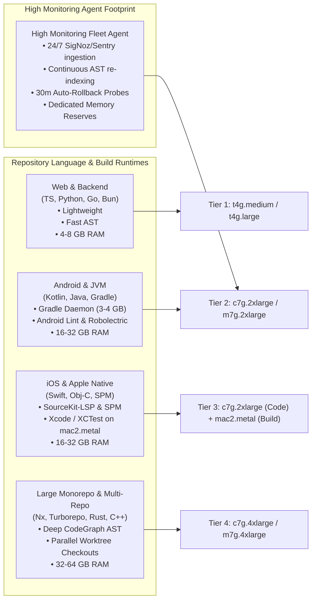
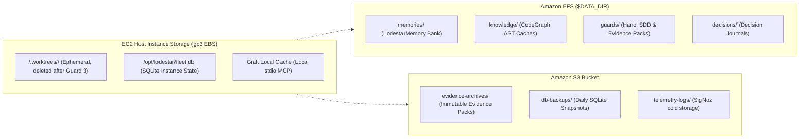
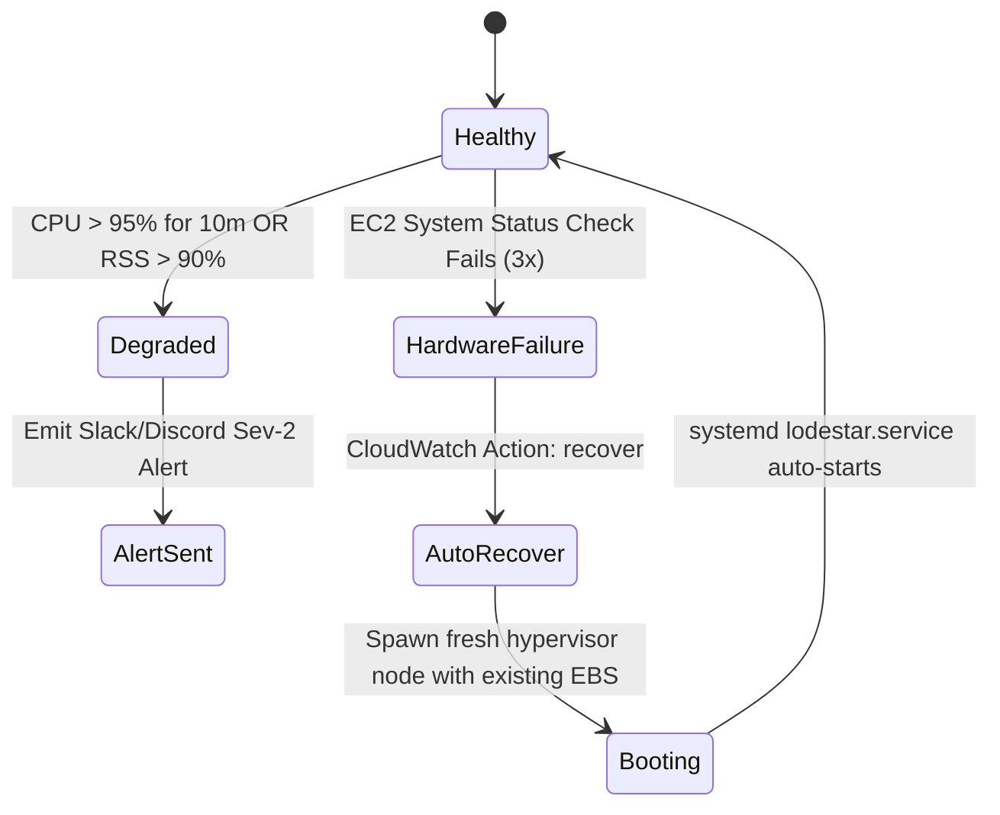

# Lodestar: AWS Production Deployment Design

> **Production-grade AWS Cloud Infrastructure Design, Terraform Infrastructure-as-Code (IaC), Security Architecture, and Operational Runbooks for Lodestar Multi-Agent Software Factory.**

---

## 1. Executive Summary & AWS Topology

Lodestar is architected to run as a high-availability, self-healing service on AWS. It combines a **Control Plane** (managing multi-repo GitHub issue queues, live dashboard UI on `:3000`, metrics, and SQLite fleet bookkeeping) and a **Worker Pool** (isolated Git worktrees running Claude Code CLI, Gemini, Kimi, and DeepSeek with AST analysis via CodeGraph and Graft).

### AWS Reference Architecture Diagram



---

## 2. AWS Compute Selection & Sizing Matrix

### 2.1 Compute Strategy: EC2 Graviton vs ECS Fargate vs EKS

| Dimension | Option A: EC2 Graviton (Recommended) | Option B: ECS Fargate | Option C: AWS EKS |
|---|---|---|---|
| **Architecture Fit** | **Optimal**: Matches the Machinist process supervisor pattern with raw local filesystem access for Git worktrees and `bun:sqlite`. | Moderate: Task lifecycle overhead when managing persistent child processes and local worktree checkouts. | Overkill: Significant cluster management overhead for single-node / multi-worker setups. |
| **Performance** | High: Direct NVMe EBS IOPS for fast AST parsing (CodeGraph Rust kernel) and zero virtualization penalty. | Moderate: Storage I/O constraints on ephemeral volumes. | High: Scales horizontally across nodes. |
| **Cost / Mo** | **~$35 – $75 / mo** (ARM Graviton3 t4g/c7g). | ~$80 – $140 / mo. | ~$150+ / mo (Control plane + Node groups). |
| **Verdict** | **Primary Choice**: Best balance of low latency, high disk I/O, process stability, and cost-efficiency. | Suitable for stateless multi-tenant scale-out. | Recommended only for enterprise-wide multi-cluster fleets. |

### 2.2 Workload Profiling by Repository Language & Ecosystem

Different language runtimes, build tools, and repository scales impose drastically different CPU, RAM, and disk I/O requirements on Lodestar's worker pool and background monitors:



#### Detailed Language & Subsystem Resource Footprints
1. **Android & JVM Ecosystems (Kotlin, Java, Gradle, Android SDK/NDK)**:
   - **Memory Demands**: Gradle Daemon maintains an active in-memory daemon ($2.5\text{ GB} - 4.0\text{ GB}$ heap). Kotlin compiler ($kotlinc$, KAPT/KSP symbol processing) consumes $2.0\text{ GB} - 4.0\text{ GB}$. Android Lint passes and local Robolectric tests add another $2.0\text{ GB} - 4.0\text{ GB}$ per concurrent worker.
   - **AST & Tooling**: CodeGraph indexes hundreds of `.kt`, `.java`, and Android resource `.xml` layout files.
   - **Recommended Node**: **`c7g.2xlarge`** or **`m7g.2xlarge`** (8 vCPU, 16–32 GB RAM).
2. **iOS & Apple Native Ecosystems (Swift, Objective-C, CocoaPods, Swift Package Manager)**:
   - **Memory & Compiler Demands**: Swift compiler (`swiftc`), `SourceKit-LSP`, and SPM package resolution require significant memory during syntax tree evaluation.
   - **Build Execution Strategy**:
     - *Code Editing, SDD Shaping, Planning & Review*: Runs on standard **`c7g.2xlarge`** Linux ARM64 instance.
     - *Native Xcodebuild & XCTest / Simulator Execution*: Dispatches headless build/test runs via SSH/runner to an AWS EC2 Mac dedicated bare-metal instance (**`mac2.metal`** M1/M2 Apple Silicon, 12 vCPU, 32 GB RAM).
3. **Massive Monorepos & Multi-Package Architectures (Nx, Turborepo, Go Workspaces, Rust Cargo, C++)**:
   - **Disk & I/O Demands**: Concurrent Git worktrees (`.worktrees/<track_id>/`) check out full copies of 100k+ file repositories, requiring high EBS burst throughput ($250\text{ MB/s} - 500\text{ MB/s}$) and $\ge 6,000$ IOPS.
   - **Cross-File AST Navigation**: CodeGraph and Graft build extensive dependency graphs with tens of thousands of symbol nodes stored in memory and `$DATA_DIR`.
   - **Recommended Node**: **`c7g.4xlarge`** or **`m7g.4xlarge`** (16 vCPU, 32–64 GB RAM, 500 GB gp3 NVMe).
4. **High Monitoring Continuous Agent (Log Ingestion, Sentry/SigNoz Spikes & Auto-Rollback Engine)**:
   - **Continuous Load**: 24/7 ingestion of real-time Sentry exceptions, SigNoz trace anomalies, and GitHub webhook streams with PII regex scrubbing.
   - **Continuous Knowledge Refresh**: Automatically triggers incremental CodeGraph AST re-indexing upon every merged commit or deploy across watched repositories.
   - **Dedicated Telemetry Headroom**: Requires dedicated CPU cores and reserved RAM to compute real-time Cycle Time, Evidence Completeness, and 30-minute post-deploy rollback probe monitors without starving active coding workers.

---

### 2.3 Comprehensive AWS Instance Sizing Matrix

| Target Workload / Language Profile | Recommended AWS Instance | Specs (vCPU / RAM) | EBS Volume (gp3) | Concurrent Workers | High Monitoring Capacity | Est. Cost / Mo |
|---|---|---|---|---|---|---|
| **Tier 1: Standard Web & Backend**<br>*(TypeScript, Node.js, Bun, Python, Go)* | **`t4g.xlarge`** | 4 vCPU / 16 GB | 100 GB<br>(6,000 IOPS) | 4 workers | Standard (1-3 repos, polling every 30s) | **~$72 / mo** |
| **Tier 2: Android / JVM / High Monitoring**<br>*(Kotlin, Java, Gradle Daemon, SigNoz Sentinel)* | **`c7g.2xlarge`** / **`m7g.2xlarge`** | 8 vCPU / 16–32 GB | 250 GB<br>(10,000 IOPS) | 6-8 workers | **High** (5-10 repos, continuous AST indexing + SigNoz/Sentry webhooks) | **~$148 / mo** |
| **Tier 3: iOS Native & Cross-Platform**<br>*(Swift, Xcodebuild, React Native, Flutter)* | **`c7g.2xlarge`** (Agent)<br>+ **`mac2.metal`** (Xcode host) | 8 vCPU / 16 GB<br>+ 12 vCPU / 32 GB | 250 GB gp3<br>+ 500 GB EBS | 4-8 workers | **High** (Continuous mobile app test & screenshot regression suite) | **~$148 / mo**<br>*(+$450 mac2)* |
| **Tier 4: Enterprise Monorepo & Fleet**<br>*(100k+ files, Rust, C++, Multi-Repo Campaigns)* | **`c7g.4xlarge`** / **`m7g.4xlarge`** | 16 vCPU / 32–64 GB | 500 GB<br>(12,000 IOPS) | 16+ workers | **Ultra** (15+ repos, real-time cross-repo AST graph sync & auto-rollback) | **~$295 / mo** |

---

## 3. Storage & Persistence Architecture



1. **Host-Local NVMe EBS Volume (`/dev/xvda` - `gp3`)**:
   - Stores the operating system, Bun runtime, local Git worktrees (`.worktrees/<track_id>/`), and the local SQLite database (`fleet.db`).
   - Cleaned up automatically upon Guard 3 certification to prevent unbounded disk growth.
2. **Central Shared Knowledge (`Amazon EFS` mounted at `/opt/LoadstoneNexus`)**:
   - Configured via `DATA_DIR=/opt/LoadstoneNexus`.
   - Stores `LodestarMemory`, cross-repo AST indices, Hanoi SDD documents (`intent.md`, `spec.md`, `design.md`, `plan.md`), and `guard-evidence.md`.
   - Shared across multiple instances if scaling to a multi-node fleet.
3. **Audit & Backup Object Storage (`Amazon S3`)**:
   - Bucket: `s3://lodestar-artifacts-<account-id>-<region>`.
   - Encrypted with AWS KMS (`aws/s3`).
   - S3 Object Lock (WORM - Write Once, Read Many) enabled for Guard 3 evidence packs to ensure cryptographic immutability.

---

## 4. Security Architecture & IAM Least-Privilege

### 4.1 Zero-Credential IAM Instance Profile
No API keys or AWS secret access keys are stored on the EC2 filesystem. The instance assumes an IAM Role (`LodestarInstanceRole`) with scoped permissions:

```json
{
  "Version": "2012-10-17",
  "Statement": [
    {
      "Sid": "SecretsManagerAccess",
      "Effect": "Allow",
      "Action": [
        "secretsmanager:GetSecretValue",
        "secretsmanager:DescribeSecret"
      ],
      "Resource": "arn:aws:secretsmanager:*:*:secret:lodestar/*"
    },
    {
      "Sid": "S3ArtifactStorage",
      "Effect": "Allow",
      "Action": [
        "s3:PutObject",
        "s3:GetObject",
        "s3:ListBucket"
      ],
      "Resource": [
        "arn:aws:s3:::lodestar-artifacts-*",
        "arn:aws:s3:::lodestar-artifacts-*/*"
      ]
    },
    {
      "Sid": "SSMManagedInstanceCore",
      "Effect": "Allow",
      "Action": [
        "ssm:UpdateInstanceInformation",
        "ssmmessages:CreateControlChannel",
        "ssmmessages:CreateDataChannel",
        "ssmmessages:OpenControlChannel",
        "ssmmessages:OpenDataChannel"
      ],
      "Resource": "*"
    },
    {
      "Sid": "CloudWatchMetricsAndLogs",
      "Effect": "Allow",
      "Action": [
        "cloudwatch:PutMetricData",
        "logs:CreateLogGroup",
        "logs:CreateLogStream",
        "logs:PutLogEvents"
      ],
      "Resource": "*"
    }
  ]
}
```

### 4.2 AWS Secrets Manager Integration
Secrets are stored in AWS Secrets Manager under `lodestar/production`:
- `ANTHROPIC_API_KEY`: Anthropic Claude API Key.
- `GEMINI_API_KEY`: Google Gemini Pro API Key.
- `KIMI_API_KEY`: Moonshot Kimi API Key.
- `DEEPSEEK_API_KEY`: DeepSeek API Key.
- `GITHUB_TOKEN` / `GITHUB_APP_PRIVATE_KEY`: GitHub Authentication credentials.
- `SLACK_WEBHOOK_URL` / `DISCORD_WEBHOOK_URL`: Notification webhooks.

At boot time, `systemd` executes `/usr/local/bin/fetch-secrets.sh` to populate the runtime environment variables in `/opt/lodestar/.env` securely with mode `0600`.

### 4.3 Network Security & Zero-Bastion Shell Access
- **No Inbound Port 22 (SSH Closed)**: All administration is conducted via **AWS Systems Manager (SSM) Session Manager** (`aws ssm start-session --target <instance-id>`).
- **Private Subnet Placement**: The EC2 instance resides in a private subnet with no public IP; all egress traffic routes through an AWS NAT Gateway.
- **ALB Security Group**: Only allows inbound HTTP (port 80 $\rightarrow$ 301 redirect to 443) and HTTPS (port 443).
- **Host Security Group**: Only allows inbound port 3000 originating from the ALB Security Group ID.

---

## 5. Terraform Infrastructure as Code (IaC)

Complete Terraform module to deploy the production infrastructure on AWS.

```hcl
# main.tf - Lodestar Production AWS Deployment

terraform {
  required_version = ">= 1.5.0"
  required_providers {
    aws = {
      source  = "hashicorp/aws"
      version = "~> 5.0"
    }
  }
}

provider "aws" {
  region = var.aws_region
}

# --- VPC & Networking ---
module "vpc" {
  source  = "terraform-aws-modules/vpc/aws"
  version = "~> 5.0"

  name = "lodestar-vpc"
  cidr = "10.0.0.0/16"

  azs             = ["${var.aws_region}a", "${var.aws_region}b"]
  private_subnets = ["10.0.1.0/24", "10.0.2.0/24"]
  public_subnets  = ["10.0.101.0/24", "10.0.102.0/24"]

  enable_nat_gateway   = true
  single_nat_gateway   = true
  enable_dns_hostnames = true
  enable_dns_support   = true

  tags = {
    Environment = "production"
    Application = "Lodestar"
  }
}

# --- Security Groups ---
resource "aws_security_group" "alb_sg" {
  name        = "lodestar-alb-sg"
  description = "Allow inbound HTTPS from internet"
  vpc_id      = module.vpc.vpc_id

  ingress {
    from_port   = 443
    to_port     = 443
    protocol    = "tcp"
    cidr_blocks = var.allowed_cidr_blocks # Restrict to office/VPN CIDRs if private
  }

  egress {
    from_port   = 0
    to_port     = 0
    protocol    = "-1"
    cidr_blocks = ["0.0.0.0/0"]
  }
}

resource "aws_security_group" "instance_sg" {
  name        = "lodestar-instance-sg"
  description = "Allow inbound from ALB only"
  vpc_id      = module.vpc.vpc_id

  ingress {
    from_port       = 3000
    to_port         = 3000
    protocol        = "tcp"
    security_groups = [aws_security_group.alb_sg.id]
  }

  egress {
    from_port   = 0
    to_port     = 0
    protocol    = "-1"
    cidr_blocks = ["0.0.0.0/0"]
  }
}

# --- EFS File System ($DATA_DIR) ---
resource "aws_efs_file_system" "data_dir" {
  creation_token = "lodestar-data-dir"
  encrypted      = true
  throughput_mode = "elastic"

  tags = {
    Name = "Lodestar-DataDir"
  }
}

resource "aws_efs_mount_target" "mount_targets" {
  count           = length(module.vpc.private_subnets)
  file_system_id  = aws_efs_file_system.data_dir.id
  subnet_id       = module.vpc.private_subnets[count.index]
  security_groups = [aws_security_group.instance_sg.id]
}

# --- S3 Artifact & Backup Bucket ---
resource "aws_s3_bucket" "artifacts" {
  bucket_prefix = "lodestar-artifacts-"
  force_destroy = false
}

resource "aws_s3_bucket_versioning" "artifacts_versioning" {
  bucket = aws_s3_bucket.artifacts.id
  versioning_configuration {
    status = "Enabled"
  }
}

resource "aws_s3_bucket_server_side_encryption_configuration" "artifacts_encryption" {
  bucket = aws_s3_bucket.artifacts.id
  rule {
    apply_server_side_encryption_by_default {
      sse_algorithm = "AES256"
    }
  }
}

# --- EC2 Instance (Graviton3 ARM64) ---
data "aws_ami" "ubuntu_arm64" {
  most_recent = true
  owners      = ["099720109477"] # Canonical

  filter {
    name   = "name"
    values = ["ubuntu/images/hvm-ssd/ubuntu-noble-24.04-arm64-server-*"]
  }

  filter {
    name   = "virtualization-type"
    values = ["hvm"]
  }
}

resource "aws_iam_role" "instance_role" {
  name = "LodestarEC2Role"

  assume_role_policy = jsonencode({
    Version = "2012-10-17"
    Statement = [{
      Action    = "sts:AssumeRole"
      Effect    = "Allow"
      Principal = { Service = "ec2.amazonaws.com" }
    }]
  })
}

resource "aws_iam_role_policy_attachment" "ssm_attach" {
  role       = aws_iam_role.instance_role.name
  policy_arn = "arn:aws:iam::aws:policy/AmazonSSMManagedInstanceCore"
}

resource "aws_iam_instance_profile" "instance_profile" {
  name = "LodestarInstanceProfile"
  role = aws_iam_role.instance_role.name
}

resource "aws_instance" "lodestar" {
  ami                  = data.aws_ami.ubuntu_arm64.id
  instance_type        = var.instance_type
  subnet_id            = module.vpc.private_subnets[0]
  vpc_security_group_ids = [aws_security_group.instance_sg.id]
  iam_instance_profile = aws_iam_instance_profile.instance_profile.name

  root_block_device {
    volume_size           = 100
    volume_type           = "gp3"
    iops                  = 6000
    throughput            = 250
    encrypted             = true
    delete_on_termination = true
  }

  user_data = templatefile("${path.module}/cloud-init.sh", {
    efs_id        = aws_efs_file_system.data_dir.id
    s3_bucket     = aws_s3_bucket.artifacts.id
    aws_region    = var.aws_region
  })

  tags = {
    Name = "Lodestar-Host"
  }
}

# --- Application Load Balancer ---
resource "aws_lb" "alb" {
  name               = "lodestar-alb"
  internal           = false
  load_balancer_type = "application"
  security_groups    = [aws_security_group.alb_sg.id]
  subnets            = module.vpc.public_subnets

  tags = {
    Name = "Lodestar-ALB"
  }
}

resource "aws_lb_target_group" "tg" {
  name        = "lodestar-tg"
  port        = 3000
  protocol    = "HTTP"
  vpc_id      = module.vpc.vpc_id
  target_type = "instance"

  health_check {
    path                = "/api/health"
    port                = "3000"
    interval            = 15
    timeout             = 5
    healthy_threshold   = 2
    unhealthy_threshold = 3
    matcher             = "200"
  }
}

resource "aws_lb_target_group_attachment" "tg_attach" {
  target_group_arn = aws_lb_target_group.tg.arn
  target_id        = aws_instance.lodestar.id
  port             = 3000
}

resource "aws_lb_listener" "https" {
  load_balancer_arn = aws_lb.alb.arn
  port              = 443
  protocol          = "HTTPS"
  ssl_policy        = "ELBSecurityPolicy-TLS13-1-2-2021-06"
  certificate_arn   = var.acm_certificate_arn

  default_action {
    type             = "forward"
    target_group_arn = aws_lb_target_group.tg.arn
  }
}
```

---

## 6. CloudWatch Alarms & Auto-Healing Configuration

To ensure continuous unattended operations, AWS CloudWatch provides automated health remediation:



1. **EC2 System Status Check Auto-Recovery Alarm**:
   - Metric: `StatusCheckFailed_System` $\ge 1$ for 2 consecutive minutes.
   - Action: `arn:aws:automate:<region>:ec2:recover`.
   - Effect: Automatically migrates the instance and attached EBS volume to a healthy physical host without data loss.
2. **Rate-Limit & Token Spend Alarm**:
   - Emits metric `Lodestar/RateLimitPausedWorkers` to CloudWatch.
   - Triggers SNS notification if $> 50\%$ of workers enter `paused_rate_limited` simultaneously.
3. **Database & Central Storage Health**:
   - Periodic cron checks SQLite integrity (`PRAGMA integrity_check;`) and uploads daily snapshots to S3.

---

## 7. Deployment Runbook & Operational Commands

### Step 1: Provision Infrastructure via Terraform
```bash
cd deploy/terraform
terraform init
terraform plan -out=tfplan
terraform apply tfplan
```

### Step 2: Access the Instance via AWS SSM (No SSH Key Needed)
```bash
aws ssm start-session --target $(terraform output -raw instance_id)
```

### Step 3: Monitor Live Daemon & Fleet Logs
```bash
# Check systemd service status
sudo systemctl status lodestar

# Tail live application and worker stream logs
sudo journalctl -u lodestar -f -o cat
```

### Step 4: Verify Dashboard & Health Check Endpoint
```bash
# Test local endpoint
curl -s http://localhost:3000/api/health | jq .

# Verify ALB HTTPS endpoint
curl -s https://lodestar.yourdomain.com/api/health | jq .
```

---

## 8. Monthly Cost Breakdown (AWS Cost Model)

| Component | AWS Resource Details | Monthly Cost (USD) |
|---|---|---|
| **Compute** | EC2 `t4g.xlarge` (4 vCPU, 16 GB RAM, Savings Plan 1-Yr) | $51.84 |
| **Storage (EBS)** | 100 GB gp3 SSD (6,000 IOPS, 250 MB/s) | $12.80 |
| **Storage (EFS)** | 20 GB Elastic EFS (Central Knowledge & Memories) | $6.00 |
| **Networking** | 1 Application Load Balancer + NAT Gateway (Outbound traffic) | $32.40 |
| **Security & Logging** | Secrets Manager (1 Secret) + CloudWatch Metrics/Logs | $4.50 |
| **Total Monthly Cost** | **Fully Managed Enterprise Deployment** | **~$107.54 / mo** |
