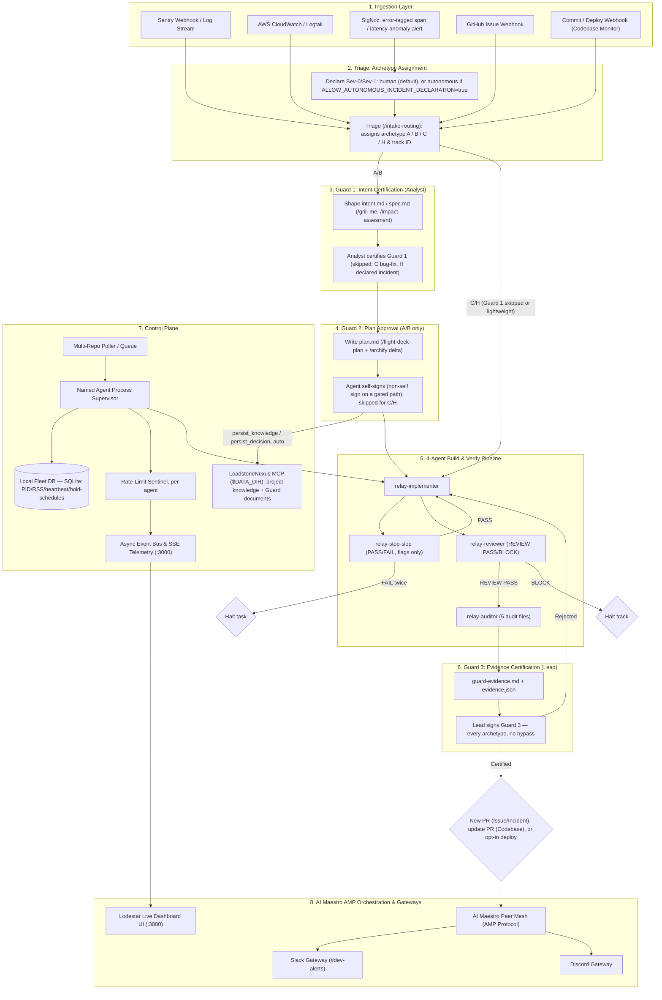

# Lodestar Functional Block Diagram

A complete functional block diagram illustrating the data flow, signal paths, control boundaries, and component interactions across **Lodestar**, **Relay Architecture (Guard 1, Guard 2 & Guard 3, adopted from [barantheva/relay](https://github.com/barantheva/relay))**, and **AI Maestro AMP**.

---

## 1. High-Level Functional Block Architecture

---

## 2. Functional Description by Layer

### Layer 1: Ingestion Layer
* **Function**: Ingests raw telemetry, exception stack traces, and manual issue triggers from external production monitoring systems (Sentry, CloudWatch, SigNoz, GitHub) plus commit/deploy events for the Codebase Monitor job type. Whichever source raises the work, it enters the **same** Triage → Guard 1/2 → Build → Guard 3 path — no separate/manual lane per source.
* **SigNoz as a trigger, not just a viewer**: an error-tagged span or a latency spike outside SLO on a trace raises the same kind of event Sentry/CloudWatch would. By default, it only *proposes* a Sev-0/Sev-1 incident — a **human declares it** before Triage may assign archetype H (Relay's rule: H is never agent-inferred from severity signals). `ALLOW_AUTONOMOUS_INCIDENT_DECLARATION=true` (opt-in, off by default) is the one deliberate exception — see `architecture.md` §1.

### Layer 2: Triage — Archetype Assignment
* **Function**: Assigns one of four archetypes before anything else runs, per Relay's own rules:
  - **A** — new surface, unclear problem, no ACs: full cycle, both guards.
  - **B** — brownfield, ACs partial or contested: shape first, then full cycle, both guards.
  - **C** — complete ACs, bounded diff: lightweight Guard 1 (skipped entirely for a genuine bug fix), autopilot, Guard 3 to merge.
  - **H** — a Sev-0/Sev-1 production incident, bounded diff: Guard 1 skipped by definition, autopilot, Guard 3 to merge, RCA owed after. Declared by a human by default; autonomously only if `ALLOW_AUTONOMOUS_INCIDENT_DECLARATION=true`.

### Layer 3: Guard 1 — Intent Certification (Analyst)
* **Function**: A named human (Analyst, independent of whoever builds) certifies `intent.md` before any build starts (with `/impact-assesment` attached if multi-app/service). Bypassed only by archetype C's bug-fix carve-out or H's declared-incident carve-out — never by Lodestar's own judgment.

### Layer 4: Guard 2 — Plan Approval
* **Function**: Applies only to archetypes A/B. Whoever wrote `plan.md` may self-sign it — since Lodestar's Engineer is always the LLM agent, this is **always automatic**, immediately, linking `/archify` delta diagrams if architecture changed, except on a gated path (PII/auth/authz/audit-logging), which forces a non-self (human) sign. On self-sign, `plan.md` and the certification line auto-commit to the PR branch and auto-persist to LoadstoneNexus MCP (`persist_knowledge`/`persist_decision`) — both destinations, no wait. Skipped entirely for C/H (autopilot collapses build→ship into one unattended run).

### Layer 5: 4-Agent Build & Verify Pipeline
* **Function**: Executes the plan inside an isolated Git worktree (`.worktrees/<track_id>/`):
  1. **`relay-implementer`**: writes code for the in-flight task, adhering to Google Style Guides (`flight-deck/code_styleguides/`) and comment rules (WHY not WHAT, 4 canonical tags, ≤15 words), using CodeGraph/Graft for context and Hanoi Rainbow's `spec.md`/`design.md`/`plan.md` as its brief.
  2. **`relay-stop-slop`**: flags-only diff check; `PASS` to advance, `FAIL` twice on the same task halts it. Checks `flight-deck/learnings.md` before scanning.
  3. **`relay-reviewer`**: full-diff review after a rebase check; `REVIEW PASS` to advance, `BLOCK` halts the track. A gated path always routes through this agent, regardless of archetype.
  4. **`relay-auditor`**: produces 5 audit files including `guard-evidence.md`/`evidence.json` for Guard 3.

### Layer 6: Guard 3 — Evidence Certification (Lead)
* **Function**: A named human (Lead, independent of whoever built the track) signs the certification block in `guard-evidence.md` (mirrored in `evidence.json`) after reviewing the evidence pack. **No bypass, on any archetype.** Evidence that changes after signing voids that signature. On certification: a **new** draft PR (Issue Monitor, Incident Monitor), an **update to the existing/related PR** (Codebase Monitor), or an **opt-in automated deployment** if declared in `flight-deck/workflow.md`.

### Layer 7: Control Plane
* **Function**: Manages multi-repo job queues, orchestrates worker processes, tracks token burn rates per agent, and powers the live operations dashboard at port 3000. Job/fleet operational state (PID, RSS, heartbeat, rate-limit hold schedules) lives in the **local Fleet DB (SQLite)** — instance-local, never sent to LoadstoneNexus. Project knowledge and Guard documents (`intent.md`, `spec.md`, `plan.md`, `guard-evidence.md`, `evidence.json`, decisions, memories) go to **LoadstoneNexus MCP**.

### Layer 8: AI Maestro AMP Orchestration & Gateways
* **Function**: Connects Lodestar to the **AI Maestro Peer Mesh Network** via the **Agent Messaging Protocol (AMP)**:
  1. Sends inter-agent status updates between local and remote worker nodes.
  2. Pushes real-time alerts to team channels (Slack `#dev-alerts`, Discord) via secure organizational gateways.

**Distributed tracing**: once worker nodes span multiple machines, correlate a task across the pipeline with OpenTelemetry + SigNoz (+ SigNoz UI for viewing traces, metrics, logs) rather than log-reading alone. Deferred until the fleet is actually multi-machine. (MIT-compatible.)

**Considered and deferred: measure-sh** for the Ingestion Layer — mobile-only crash/ANR/session-replay platform (Apache-2.0). No fit today since these repos are backend/web only; would slot in as another Ingestion Layer source alongside Sentry/CloudWatch if a mobile-client repo is ever added.
