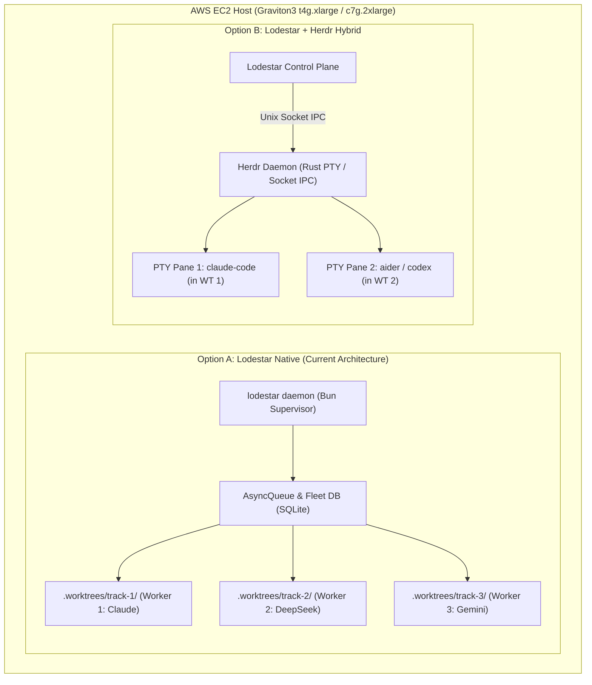

# Herdr Evaluation Report: Architecture, Performance, & Trade-Offs for Lodestar

This report evaluates [herdr](https://github.com/herdrdev/herdr) (`herdrdev/herdr`) — a Rust-based terminal workspace manager and agent runtime — as a runtime layer for running multi-agent workloads on a single EC2 host alongside or within [Lodestar](../README.md). It is the single Herdr document; the former `docs/headr.md` stub pointed here and has been folded in.

---

## 1. Executive Summary

| Dimension | Lodestar Native Engine | Herdr (`herdrdev/herdr`) | Hybrid Synthesis |
| :--- | :--- | :--- | :--- |
| **Primary Role** | Autonomous SDD orchestrator, Guard 1/2/3 pipeline, Web UI, multi-provider SDK coordinator. | Terminal workspace manager & PTY multiplexer daemon for interactive/CLI AI coding agents. | Use Lodestar as the control plane; optionally leverage Herdr for PTY-bound CLI agents (`claude-code`). |
| **Language & Runtime** | TypeScript / Bun 1.4 / `bun:sqlite` | Rust 2021 / `ratatui` / `portable-pty` / `interprocess` | Complementary binaries on a single Linux/ARM64 VM. |
| **Workspace Isolation** | Ephemeral Git Worktrees (`.worktrees/<track_id>/`) with automatic Guard 3 cleanup. | Terminal panes & sessions with saved layout restoration. | Lodestar provisions the worktree, Herdr manages the PTY session inside it. |
| **Supervision Model** | SQLite-backed Process Sensor (PID, RSS, CPU%, Rate-limit Hold/Resume). | Unix socket IPC (`interprocess`), background daemon with layout persistence. | Lodestar supervisor queries Herdr IPC or maintains direct process handles. |
| **UI Surface** | Web Dashboard (:3000, 16 server-rendered screens; SSE hub built but not yet wired to screens). | Terminal TUI (`ratatui`) + SSH attachable/detachable sessions. | Web dashboard for fleet observability; Herdr TUI for terminal-level debugging. |

---

## 2. What is Herdr?

Herdr is an open-source (Apache-2.0) Rust runtime specifically engineered for AI coding agents (Claude Code, Codex, Aider, OpenCode):
1. **Daemonized PTY Server**: Keeps agent terminal sessions running in a background server process, surviving SSH drops and client disconnections.
2. **Session Persistence**: Restores terminal layouts and can reconnect to supported agent sessions across reconnects.
3. **IPC Control Interface**: Exposes a structured IPC API (`bincode` / JSON schema over domain sockets) to programmatically spawn, steer, and capture outputs from CLI agents.
4. **Rust Performance**: Ultra-low memory footprint (~15–30 MB for the daemon) with zero garbage-collection pauses and efficient native pseudo-terminal handling.

---

## 3. How Multiple Agents Run: Native Lodestar vs. Herdr on a Single EC2

### Option A: Lodestar Native Engine (Current)
* **Direct API / Child Process**: Lodestar talks directly to LLMs via model adapters ([`anthropic-adapter.ts`](../src/adapters/anthropic-adapter.ts), [`deepseek-adapter.ts`](../src/adapters/deepseek-adapter.ts), [`gemini-adapter.ts`](../src/adapters/gemini-adapter.ts)) or spawns headless child processes with direct `stdio` piping.
* **Granular Guard Control**: Pipeline steps (Guard 1 Triage → Guard 2 Plan self-signing → Relay Implementer → Stop-Slop → Reviewer → Guard 3 PR/Deploy) execute as deterministic async state machines.
* **Dynamic Worktrees**: Fast local Git worktree allocation and auto-pruning.

### Option B: Lodestar + Herdr Integrated Runtime
* **PTY Encapsulation**: For agents that only exist as interactive terminal CLI binaries (e.g., Anthropic's `claude-code` CLI or interactive tools requiring full TTY emulation).
* **Herdr as Process Sandbox**: Lodestar delegates the PTY lifecycle and attachable terminal buffers to Herdr via its local IPC socket.

---

## 4. Performance Analysis on a Single EC2 Instance

### 4.1 Compute & Memory Footprint

| Metric | Lodestar Native Engine | Herdr Runtime | Combined Impact on `t4g.xlarge` (16 GB) |
| :--- | :--- | :--- | :--- |
| **Daemon Base RSS** | ~45–70 MB (Bun runtime + Web server) | ~15–30 MB (Rust compiled binary) | **< 100 MB total overhead** |
| **Per-Agent Overhead** | ~10–25 MB (Async task context) | ~5–12 MB (PTY session + buffer) | Minimal; LLM inference is remote |
| **Heavy Memory Consumers** | CodeGraph AST parsing (~200–500 MB peak), Compiler/Test runs (1–4 GB per worker) | PTY scrollback buffers (~10–50 MB) | System capacity dominated by compiler/test suites, not the supervisor |
| **CPU Utilization (Idle)** | < 0.5% vCPU | < 0.1% vCPU | Negligible |
| **I/O & Socket Latency** | Sub-millisecond (in-memory event bus + SQLite) | Sub-millisecond (Unix domain sockets) | High throughput; no network roundtrip |

### 4.2 EBS Disk & IOPS Profile
* Neither Lodestar nor Herdr produces heavy disk writes in their supervisor layer.
* Disk I/O bottlenecks on single EC2 instances stem from **concurrent Git worktree checkouts** and **build artifacts** (`node_modules`, Gradle caches, target folders).
* Herdr does not solve worktree disk accumulation on its own; Lodestar's **Guard 3 worktree auto-cleanup** remains essential.

---

## 5. Trade-Offs Matrix

### Advantages of Herdr
1. **True PTY/TTY Emulation**: If running third-party CLI agents that mandate a real TTY (`portable-pty`), Herdr handles terminal dimensions, ANSI escape parsing, and interactive prompts cleanly.
2. **Interactive SSH Attach/Detach**: Engineers can SSH into the EC2 instance, run `herdr attach`, and interactively inspect or take over an agent's terminal pane in real time.
3. **Resilience to SSH Drops**: Unattended interactive runs do not get terminated when network connections drop.
4. **Rust Efficiency & Safety**: No runtime garbage collection spikes or Node/Bun event-loop starvation during intensive PTY I/O.

### Disadvantages & Trade-offs
1. **Dual-Stack Complexity**: Adds a Rust binary, Cargo build toolchain (or prebuilt binary packaging in Docker/cloud-init), and IPC socket management alongside Bun TypeScript.
2. **Missing Autonomous Guard Pipeline**: Herdr is an *agent workspace runtime*, not an *autonomous software factory*. It has no concept of Guard 1 triage, Hanoi Rainbow Spec-Driven Development, Evidence Completeness scoring, or Guard 3 auto-revert deployment monitors.
3. **Redundant Observability**: Lodestar already features a dedicated 16-screen web dashboard (`http://<ec2-ip>:3000`, started with `lodestar dashboard`) and SQLite Fleet DB tracking PID, CPU%, RSS, and heartbeat. Herdr's TUI is redundant for automated headless pipelines unless terminal-level interactive intervention is specifically desired.
4. **IPC Translation Overhead**: Driving CLI agents via PTY/IPC requires parsing raw ANSI/text output instead of consuming typed JSON responses from direct SDK adapters.

---

## 6. Recommendations & Roadmap

1. **Keep Lodestar Native Core as the Default**:
   - For automated headless execution (Issue Monitor, Codebase Monitor, Log Incident Monitor), keep Lodestar's direct SDK adapters and `bun:sqlite` process sensor. It delivers lower complexity, typed structured outputs, and direct Guard 1/2/3 integration.

2. **Optional Herdr Integration for Interactive CLI Agents**:
   - If deploying third-party CLI agents (`claude-code`, `aider`) that require full PTY emulation and human attachability, integrate Herdr as an optional execution backend.
   - Lodestar's `CodeExecTool` or a dedicated `HerdrAdapter` can communicate over `/tmp/herdr.sock` to orchestrate sessions while retaining Lodestar's worktree isolation and SQLite fleet tracking.
