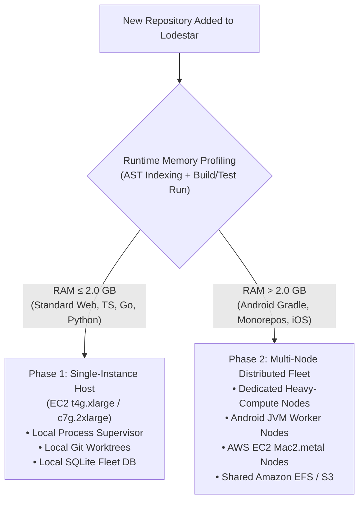
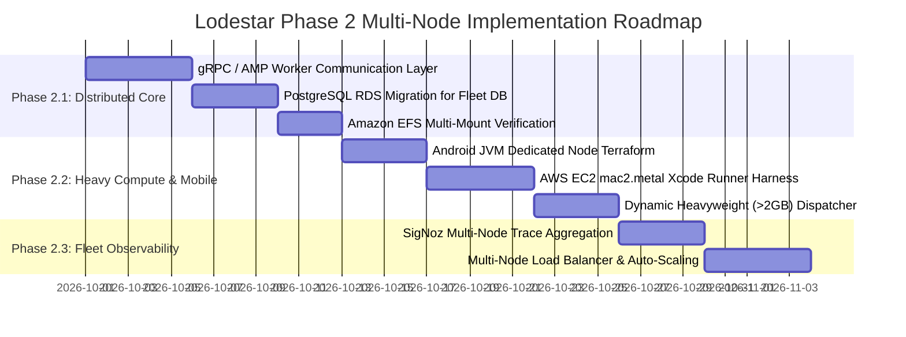

# Lodestar: Phase 2 — Multi-Node Distributed Architecture & Scaling Roadmap

> **Phase 2 Distributed Architecture Specification: Transitioning from Single-Instance Machinist Pattern to a Multi-Node Distributed Fleet, with Strict Single-Instance Resource Budgets (≤ 2 GB RAM per Repo/Worker).**

---

## 1. Single-Instance Memory Limitations & The 2 GB Repo Rule

### 1.1 The Single-Instance Resource Budget & 2 GB Limit
On a **Single Instance (Phase 1 Baseline)**, the Control Plane daemon, local SQLite database (`fleet.db`), and all active worker processes share the same host memory and CPU:

$$\text{Total Host Memory} \ge \text{RAM}_{\text{ControlPlane}} + \sum_{i=1}^{N} \text{RAM}_{\text{Worker}_i} + \text{RAM}_{\text{OS/Buffers}}$$

To prevent Out-Of-Memory (OOM) kernel panics and process starvations, Lodestar enforces a **strict single-instance memory rule**:

> [!WARNING]
> ### 🚨 The 2 GB Runtime Memory Constraint (Single Instance)
> - **Per-Repo / Worker Budget**: Each active repository track is allocated a maximum runtime memory budget of **$\le 2.0\text{ GB}$ RSS** ($\text{RAM}_{\text{repo}} \le 2.0\text{ GB}$).
> - **Repo Profiling**: Standard web backends (TypeScript, Node.js, Bun, Go, Python) naturally fit within this $\le 2\text{ GB}$ footprint.
> - **OOM Prevention Threshold**: If a repository's build/test runner or AST indexer exceeds **$> 2.0\text{ GB}$ RAM** (e.g., heavy Gradle daemons, massive monorepos, C++/Rust compilation passes), the Supervisor:
>   1. Flags the repository as **`HIGH_MEMORY_HEAVYWEIGHT`**.
>   2. Emits a telemetry warning on the live dashboard (`Screen 4: Repos stats`).
>   3. Restricts single-instance concurrency (limiting parallel jobs for that repo to 1).
>   4. **Requires migration to Phase 2 Multi-Node Architecture** for dedicated resource provisioning.

---

### 1.2 When to Transition from Phase 1 (Single-Host) to Phase 2 (Multi-Node)



#### Triggers for Phase 2 Migration:
1. **Repository Memory Footprint $> 2.0\text{ GB}$**:
   - **Android / JVM Projects**: Gradle daemon ($2.5\text{–}4.0\text{ GB}$ heap) + Kotlin compiler / KAPT ($2.0\text{–}3.0\text{ GB}$) exceeding single-instance safe headroom.
   - **Large Monorepos (100k+ files)**: CodeGraph AST indexing with $> 50,000$ cross-file symbol nodes.
   - **Native iOS Codebases**: Requiring bare-metal macOS compilation with `xcodebuild` and iOS simulators.
2. **Concurrent Fleet Scaling**:
   - Monitoring $> 10$ active repositories simultaneously with $\ge 8$ concurrent coding workers.
3. **Multi-Team & Multi-Region Isolation**:
   - Requiring independent compute nodes for security compliance, VPC segregation, or dedicated compute quotas.

---

## 2. Phase 2 Multi-Node Reference Architecture

```mermaid
graph TB
    subgraph Control_Plane_Tier["Phase 2: Central Control Plane & Ingress (Node 0)"]
        CP_Host["Control Plane VM (EC2 t4g.large / Cloud Run)"]
        DashboardUI["Lodestar Dashboard UI (:3000)"]
        GlobalQueue["Global Multi-Repo Issue Queue & Scheduler"]
        GlobalDB[("Global Fleet DB (PostgreSQL / RDS)")]
    end

    subgraph Storage_Tier["Shared Central Storage ($DATA_DIR)"]
        EFS[("Amazon EFS / NFS ($DATA_DIR)\n• LodestarMemory Bank\n• CodeGraph AST Knowledge\n• Hanoi SDD Guard Documents")]
        S3[("Amazon S3 (WORM Lock)\n• Lead Evidence Packs\n• Telemetry & DB Backups")]
    end

    subgraph Worker_Tier["Phase 2: Specialized Distributed Worker Nodes"]
        subgraph Node1["Worker Node 1: Standard Linux Web & Backend (EC2 c7g.2xlarge)"]
            W1["Worker 1 (TS/Bun)"]
            W2["Worker 2 (Go/Python)"]
            W3["Worker 3 (Rust)"]
        end

        subgraph Node2["Worker Node 2: Android & JVM Heavy Compute (EC2 m7g.2xlarge - 32GB)"]
            W4["Worker 4 (Android Kotlin)"]
            W5["Worker 5 (Java Spring)"]
            GradleDaemon["Persistent Shared Gradle Daemon Cache"]
        end

        subgraph Node3["Worker Node 3: iOS Native macOS Runner (AWS EC2 mac2.metal)"]
            W6["Worker 6 (Swift / SPM)"]
            XcodeRunner["Native Xcodebuild & iOS Simulators"]
        end
    end

    GlobalQueue -->|Dispatch Job via AMP Protocol / gRPC| Node1
    GlobalQueue -->|Dispatch Heavy Job (>2GB RAM)| Node2
    GlobalQueue -->|Dispatch iOS Xcode Job| Node3

    Node1 <--> EFS
    Node2 <--> EFS
    Node3 <--> EFS

    Node1 & Node2 & Node3 -->|Stream Telemetry & Logs| DashboardUI
    Node1 & Node2 & Node3 --> S3
```

---

## 3. Node Specifications & Workload Partitioning

| Node Role | Target Ecosystem & Repositories | Recommended AWS / Cloud Sizing | RAM Budget per Worker | Storage & File System |
|---|---|---|---|---|
| **Control Plane (Node 0)** | Multi-repo polling, Web UI (:3000), SSE telemetry, Guard sign-offs. | `t4g.large` (2 vCPU / 8 GB RAM) | N/A (Supervisor only) | 50 GB gp3 EBS + RDS Postgres |
| **Worker Node 1 (Standard)** | Web & Backend (`$\text{RAM} \le 2\text{ GB}$`): TypeScript, Python, Go, PHP. | `c7g.2xlarge` (8 vCPU / 16 GB RAM) | **$\le 2.0\text{ GB}$** / worker | 200 GB gp3 (Local worktrees) + EFS mount |
| **Worker Node 2 (JVM/Heavy)** | Android, Kotlin, Java Gradle (`$\text{RAM} > 2\text{ GB}$`), massive monorepos. | `m7g.2xlarge` (8 vCPU / 32 GB RAM) | **$4.0\text{–}8.0\text{ GB}$** / worker | 500 GB gp3 (Gradle caches) + EFS mount |
| **Worker Node 3 (macOS Native)** | iOS Swift, Objective-C, CocoaPods, native Xcode simulator testing. | `mac2.metal` (12 vCPU / 32 GB RAM M1/M2) | **$8.0\text{–}16.0\text{ GB}$** / worker | 500 GB NVMe EBS + EFS mount |

---

## 4. Phase 2 Communication & State Synchronization

1. **AI Maestro Peer Protocol (AMP) & gRPC Dispatch**:
   - The Control Plane communicates with remote worker nodes via secure gRPC / AMP Protocol over internal VPC private subnets.
   - Workers stream stdout/stderr, token consumption metrics, and Sentinel status back to the Control Plane in real-time.
2. **Shared Central Knowledge (`$DATA_DIR` on Amazon EFS)**:
   - All worker nodes mount the shared Amazon EFS file system at `/opt/LoadstoneNexus`.
   - Access to `LodestarMemory Bank`, AST knowledge graphs, and Guard documents remains uniform across all nodes through the standard `LoadstoneNexus MCP` client.
3. **Distributed Rate-Limit Sentinel**:
   - Sentinel hold schedules are persisted in the central database (`Global Fleet DB`), ensuring that if a specific model quota (e.g. Anthropic Claude) is reached, all worker nodes across the fleet coordinate pause-and-resume schedules synchronously.

---

## 5. Phase 2 Implementation Roadmap



---

## 6. Phase 2 Verification Checklist

- [ ] Single-instance daemon alerts whenever a repository track exceeds **$> 2.0\text{ GB}$ RAM** during test or indexing runs.
- [ ] Control Plane successfully dispatches tasks to remote Linux and macOS worker nodes over internal VPC gRPC channels.
- [ ] All worker nodes read and write to `LodestarMemory Bank` and Guard documents on shared Amazon EFS without file lock collisions.
- [ ] Android Gradle daemon memory consumption is isolated to Node 2 without impacting Node 1 backend workers.
- [ ] Live Operations Dashboard displays aggregated multi-node fleet metrics, worker hostnames, and per-node RAM usage.
