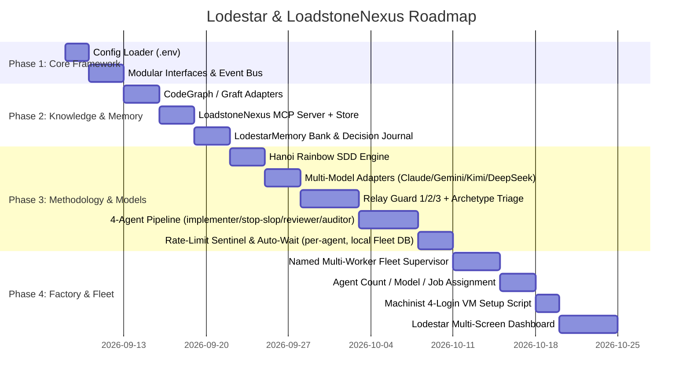

# Lodestar & LoadstoneNexus: Master Product Plan

> **The Open-Source Autonomous Software Factory for Vibecoders — One Person, or a Small Team**
> Synthesizing **Hanoi Rainbow** (Spec-Driven Development), **Relay** (Guard & Archetype Methodology), **MonoCode** (Agent Process Harness & Session Continuity), **Machinist** (VM Software Factory & 4-Login Model), **CodeGraph & Graft** (AST Code Graph & Repo Maps), **LodestarMemory** (Cross-Session Memory Bank & Living Docs), **Modular Agentic Architecture** (Plugins, Event Bus, Interfaces), and **Multi-Model Auto-Coders** (Claude, Gemini, Kimi, DeepSeek, OpenAI) with **Rate-Limit Sentinel**, **Fleet Supervision**, **Metrics & Rollback Engine**, and **LoadstoneNexus Central Storage**.

---

## 1. Executive Summary & Vision

**Lodestar** is an autonomous software factory built for vibecoders — a solo builder or a small team leaning on AI to ship, without a dedicated ops/QA org backing them up. Three things it does, continuously: **monitor** production for incidents (Sentry/CloudWatch/SigNoz), **fix issues** filed on GitHub, and **check code changes** as they land (Codebase Monitor re-indexing and catching regressions). It builds a repository knowledge base with CodeGraph and Graft; produces formal specifications before writing code; executes fixes with multi-model auto-coders (Claude, Gemini, Kimi, DeepSeek, OpenAI); routes every track through Relay's Guard 1/2/3 methodology — relaxed to a self-signed solo mode for a one-person team, or Relay's real independence rule once there's an actual Analyst and Lead (`architecture.md` §1); handles token rate-limits through a per-agent auto-wait sentinel; and opens (or updates) verified, evidence-certified Pull Requests.

---

## 2. Synthesis of Knowledge Pillars

| Knowledge Source | Core Innovation Adopted | Design |
| :--- | :--- | :--- |
| **Hanoi Rainbow** | Spec-Driven Development (SDD) | `spec.md`, `design.md`, `plan.md` generated per track before any code changes. |
| **MonoCode** | Multi-Agent Process Harness & Session Continuity | Manages the coding-agent child process per worker, with persistent session continuity across rate-limit pauses. |
| **Machinist** | Software Factory & Remote VM Architecture | Control Plane vs Worker Plane separation, unprivileged service account, 4-login security model, single-command VM setup script. |
| **CodeGraph** | Local Semantic AST Graph | Shells out to a local `codegraph` CLI (falls back to a static parser if unavailable) for cross-file callers/callees and symbol hierarchies. |
| **Graft MCP** | Structural Repo Mapping & File APIs, **local-only** (never called remotely — keeps large repo-map payloads off the network and out of LLM context; only distilled results reach the model) | Local stdio MCP server maps module boundaries and public APIs. |
| **LodestarMemory** | Cross-Session Memory Bank & Decision Journal | `learnings.md`-style self-improvement loop; gate agents read it before scanning, append on a blocked verdict. |
| **Modular Agentic AI** | Plugin System, Interfaces & Event Bus | `core/interfaces/`, `services/`, `plugins/`, `adapters/`, `event-bus.ts` — strict interface segregation, dynamic component discovery. |
| **LoadstoneNexus** | Central Persistent Data Nexus for **project knowledge and Guard documents** | Accessed via an MCP server (`persist_knowledge`/`retrieve_knowledge`/`persist_decision`) rather than raw filesystem I/O — same pattern as Graft MCP. Pluggable: `KNOWLEDGE_BACKEND=loadstonenexus` (default) or `obsidian`, same `memory-interface.ts` contract either way (`architecture.md` §3). Job/fleet operational state (PID, RSS, heartbeat, hold schedules) is deliberately excluded — that lives in the local Fleet DB (§3), never sent here. |
| **Relay Architecture** | Guard 1/2/3 semantics **adopted verbatim from [barantheva/relay](https://github.com/barantheva/relay)** (`RELAY_TEAM.md`/`RELAY.md`/`CLAUDE.md`) | 6 stages (intake → shape → plan → build → verify → ship); Guard 1 = Analyst certifies `intent.md` (requires `/impact-assesment` for multi-app changes; bypassed only by archetype C's bug-fix carve-out or H's *human-declared* incident carve-out — never agent-inferred); Guard 2 = plan approval in `plan.md` (+ `/archify` delta), self-signed automatically by the agent (Lodestar's Engineer is always the LLM) except on a gated path (PII/auth/authz/audit-logging), which forces a human sign; Guard 3 = Lead certifies the evidence pack (`guard-evidence.md` + `evidence.json`), always, no bypass; opt-in deploy after Guard 3 via `workflow.md`. See `architecture.md` §1 and §8 for the full archetype/job-type mapping. |
| **Agent Fleet Configuration** | Configurable agent count, per-agent model provider, per-agent job assignment | Claude/DeepSeek/Gemini/Kimi/OpenAI per agent; job types App/Log & Incident Monitor, Issue Monitor, Codebase Monitor, Instrumentation Campaign (`architecture.md` §7–8) — assignable at deploy time or live from the dashboard. |
| **Cross-Repo Fan-Out** | A track whose fix touches a shared contract (or an Instrumentation Campaign adding observability wrappers) spawns one child track per affected repo | Discovery via LoadstoneNexus's stored per-repo Graft/CodeGraph maps (`retrieve_knowledge` across all indexed repos) finds affected dependencies or identifies all APIs for bulk-instrumentation. Each child track gets its own PR and Guard 1/2/3, with a Bulk Guard 3 view for instrumentation rollouts. See `architecture.md` §9. |
| **Release Tracking & Tagging** | Deterministic, never-hand-typed release identity | Tag = `dd-mm-yyyy-<short commit hash>`, changelog = `change-log-<tag>.md`, both derived from repo + HEAD at creation time, no manual override. No separate release-service — extends `git-tool.ts` (implemented). See `architecture.md` §10, dashboard screens in `screen-list.md` §7b–7c. |
| **AI Maestro AMP** | Agent Messaging Protocol & Peer Mesh Orchestration | Inter-agent messaging via AMP, Slack/Discord Gateways; default deployment is a single instance, multi-machine mesh is opt-in scale-out, deferred until the fleet is actually multi-machine (`screen-list.md` §4, `impl.md`'s Deferred list). |
| **Log-Monitoring & Self-Healing** | Autonomous Ingestion, Sanitization & Triage | Sentry/CloudWatch/SigNoz watcher, regex PII scrubber, issue deduplication, archetype triage. |
| **Rate-Limit Sentinel** | Auto-Wait & Resume Quota Sentinel, **per-agent** | Each of the 4 pipeline roles (§8 in `architecture.md`) tracks its own provider's quota independently; a job that hits a limit gets a **persisted hold schedule in the local Fleet DB** (SQLite), auto-triggered once `resume_at` passes (defaulting to **+6h** if the provider gives no explicit reset time), surviving a worker restart. |
| **Metrics & Rollback Engine** | Cycle Time, Evidence Completeness, and Rollback Rate scoring computed from real Guard-signing timestamps | `metrics-calculator.ts` (`src/services/monitor-service/`, implemented) subscribes to `guard.signed`/`track.shipped`/`track.deployed` events; formulas in `plan.md` §7, contract in `impl.md` §2.5. Drives opt-in post-Guard-3 deploy plus automatic rollback on a failed post-deploy health check. |

---

## 3. Chosen Tech Stack (final)

Every choice below defaults to the simplest, most reusable option — a new dependency only where nothing simpler covers it.

| Concern | Choice | Why |
| :--- | :--- | :--- |
| Runtime & language | **Bun + TypeScript** | One language and runtime across CLI, MCP servers, and dashboard — no polyglot split. |
| CLI parsing | **`node:util` `parseArgs`** | Standard library covers it; no `commander`/`yargs` dependency needed. |
| MCP servers (LoadstoneNexus, and any Lodestar-exposed tools) | **Hand-rolled JSON-RPC 2.0 over stdio** (`node:readline` + `process.stdin`/`stdout`) — no `@modelcontextprotocol/sdk`. MCP's stdio transport is newline-delimited JSON-RPC; `initialize`/`tools/list`/`tools/call` is a small enough surface to implement and own directly. | Keeps the zero-external-runtime-dependency line (native TypeScript, Bun APIs, Node built-ins only) — the tradeoff is tracking MCP protocol/version compatibility manually instead of getting it from the SDK. |
| MCP client (calling Graft's local server, Obsidian's REST bridge) | **Same hand-rolled JSON-RPC over `node:child_process` stdio pipes** | One transport implementation, reused for both server and client roles — no second dependency for the client side either. |
| Knowledge/state storage | **Markdown files are the source of truth** (`flight-deck/tracks/<track_id>/plan.md`, `learnings.md`, `audit/*`) — Relay's own "artifact as baton" rule. LoadstoneNexus MCP is a **query/cache layer** over those files, backed by **SQLite via `bun:sqlite`** (built into Bun, zero new dependency), always rebuildable from the markdown files, never authoritative on its own. | A database that could drift from the actual `plan.md`/`learnings.md` content would be worse than no cache at all; SQLite-as-cache gets fast dashboard queries without that risk. |
| Job/fleet operational state | **Local SQLite (`bun:sqlite`), separate from LoadstoneNexus** — PID, RSS, heartbeat, session state, rate-limit hold schedules | Instance-local bookkeeping, never project knowledge — keeping it out of LoadstoneNexus means one instance's operational noise never pollutes the shared knowledge base. |
| Unified Observability (Traces, Metrics, Logs) | **Hand-rolled OTLP/HTTP JSON export via native `fetch`, no `@opentelemetry/sdk-node`** — SigNoz's collector accepts OTLP/HTTP with plain JSON (protobuf is optional, not required), so a span/trace-context struct + `fetch(collectorUrl, {method:'POST', body: JSON.stringify(otlpPayload)})` covers it without the SDK's instrumentation/exporter machinery. | Same zero-dependency line, at the cost of manually maintaining OTLP payload shape and trace-context propagation instead of the SDK doing it. Deferred until the fleet is multi-machine (`architecture.md` §6) — implement this native version when that day comes, don't reach for the SDK then either. |
| Static analysis on gated paths (PII/auth/authz/audit-logging) | **Opengrep** | Relay's own methodology already names this as its SAST tool — adopt the same choice rather than pick a second one. |
| Dashboard | **Bun HTTP server + Server-Sent Events + server-rendered HTML + vanilla JS** — no frontend framework, no bundler | A multi-screen internal ops dashboard doesn't need React/Vue's build step; matches `mock-ui.html`'s plain-HTML mock. |
| Auto-coder models | **Claude, Gemini, Kimi, DeepSeek, OpenAI** — one provider per agent role (§8's 4-agent pipeline: `relay-implementer`/`relay-stop-slop`/`relay-reviewer`/`relay-auditor`), each independently configured (`architecture.md` §7) | Follows Relay's own principle — narrow contract, one model tier per agent — while keeping multi-vendor flexibility instead of locking to Claude-only tiers. |
| Multi-repo job queue | **In-process async queue** (no Redis/Kafka/BullMQ) | Relay's own target scale is a 3-6 person team on one repo at a time; the fleet doesn't need distributed-queue infrastructure at that scale. |
| Git isolation | **`.worktrees/<track_id>/`** (Relay's own convention) | Adopting Relay's guard semantics means adopting its file/directory conventions too, not just the guard names. |
| Deployment | **Single AWS EC2 instance**, systemd-managed (`deployment.md`) | Matches Relay's own small-team scale — no multi-machine mesh by default. |

---

## 4. Modular System Architecture

See `architecture.md` §1 for the full project layout and directory-by-directory breakdown (`core/`, `services/`, `plugins/`, `adapters/`, `dashboard/`, `config/`).

---

## 5. Phased Implementation Roadmap

---

## 6. Definition of Success (DoD)
- [x] Multi-repo configuration via `GITHUB_REPO`/`ISSUE_LABEL_FILTER`, with a true multi-repo poller fanning out across several repos from one daemon.
- [ ] Cross-repo fan-out: a track whose fix touches a shared contract discovers affected repos via LoadstoneNexus's stored per-repo knowledge, spawns one child track per repo, processes them sequentially, and opens one PR per repo, cross-referenced for traceability. **Deferred** — Instrumentation Campaign fan-out isn't wired to real execution yet (`monitorsetup-page.ts`).
- [x] Central persistent data store at a configurable `$DATA_DIR`, accessed exclusively through a LoadstoneNexus MCP server (`persist_knowledge`/`retrieve_knowledge`) — no service reads/writes `$DATA_DIR` files directly.
- [x] Hanoi Rainbow SDD generating `intent.md`, `spec.md`, `design.md`, `plan.md` per track in `flight-deck/tracks/<track_id>/`, before any code changes.
- [x] Relay Guard 1/2/3 enforced on every track: Analyst-certified `intent.md`, agent-self-signed `plan.md` (human sign on gated paths), Lead-certified evidence pack (`guard-evidence.md` + `evidence.json`) — no bypass on Guard 3, ever.
- [x] The 4-agent pipeline (`relay-implementer`, `relay-stop-slop`, `relay-reviewer`, `relay-auditor`) producing `guard-evidence.md`/`evidence.json` for every track.
- [x] Multi-model auto-coders with session continuity (Claude, Gemini, Kimi, DeepSeek, OpenAI), one provider per agent role, configurable per-agent.
- [x] Rate-Limit Sentinel, per agent, with a persisted hold schedule in the local Fleet DB (SQLite) that survives a worker restart — not an in-memory timer.
- [x] Named multi-worker fleet supervisor monitoring PID, RSS, CPU, heartbeat, and auto-restart, backed by the local Fleet DB.
- [x] Agent count, per-agent model provider, and per-agent job assignment (Incident/Issue/Codebase Monitor/Instrumentation Campaign), configurable at deploy time and live from the dashboard.
- [ ] VM deployment script with systemd unit and unprivileged-user hardening, per `deployment.md`. **Not started** — no `deploy/` directory yet.
- [x] Lodestar multi-screen Live Operations Dashboard, the full screen catalog in `screen-list.md` (16 screens).
- [x] Real-time calculation engine computing Cycle Time, Evidence Completeness, Lead Sign-Off Velocity, and Rollback Rates.
- [x] Pluggable knowledge backend (`KNOWLEDGE_BACKEND=loadstonenexus|obsidian`) behind one `memory-interface.ts` contract — switching backends is a config change, no caller special-cases either one (`architecture.md` §3).
- [x] Release Tracking & Tagging: per-repo tag creation (`dd-mm-yyyy-<short commit hash>`) with an auto-drafted, auto-named changelog (`change-log-<tag>.md`) committed alongside it, and a Release Tracker screen listing every tag/changelog/bundled-track across repos (`architecture.md` §10, `screen-list.md` §7b–7c).

---

## 7. Metrics & Calculation Logic: Cycle Time, Evidence & Rollback Measurement

### 7.1 Cycle Time Calculation Logic
Cycle time measures the end-to-end velocity of a track through the 6-stage Relay lifecycle:

1. **Total Track Cycle Time ($T_{\text{cycle}}$)**:
   $$T_{\text{cycle}} = T_{\text{ship}} - T_{\text{intake}}$$
   - $T_{\text{intake}}$: Timestamp when `/intake-routing` opens the track and initializes `flight-deck/tracks/<track_id>/`.
   - $T_{\text{ship}}$: Timestamp when Guard 3 is certified by the Lead and the PR is finalized (or optional deployment completes: $T_{\text{deploy}}$).

2. **Stage-by-Stage Latency Breakdown**:
   - **Intake Latency ($\Delta T_{\text{intake}}$)**: $T_{\text{route}} - T_{\text{event\_ingest}}$ (triage & archetype classification duration).
   - **Shape Latency ($\Delta T_{\text{shape}}$)**: $T_{\text{guard1\_sign}} - T_{\text{route}}$ (spec authoring + Analyst review time).
   - **Plan Latency ($\Delta T_{\text{plan}}$)**: $T_{\text{guard2\_sign}} - T_{\text{guard1\_sign}}$ (`plan.md` generation, `/archify` diagram delta, and Engineer self-signing/gated path review).
   - **Build Latency ($\Delta T_{\text{build}}$)**: $T_{\text{slop\_pass}} - T_{\text{guard2\_sign}}$ (TDD cycles + `relay-stop-slop` scan).
   - **Verify Latency ($\Delta T_{\text{verify}}$)**: $T_{\text{review\_pass}} - T_{\text{slop\_pass}}$ (Pre-merge rebase check + SAST security scan + `relay-reviewer`).
   - **Lead Sign-Off Turnaround ($\Delta T_{\text{lead\_sign}}$)**: $T_{\text{guard3\_sign}} - T_{\text{evidence\_gen}}$ (time between Baton evidence compilation and human Lead digital signature).

3. **Aggregate Moving Average Metrics**:
   - **Org 30-Day Average Cycle Time**: $\bar{T}_{\text{30d}} = \frac{1}{N} \sum_{i=1}^{N} T_{\text{cycle}, i}$
   - **Per-Repo Cycle Time**: $\bar{T}_{\text{repo}} = \frac{1}{N_{\text{repo}}} \sum_{j=1}^{N_{\text{repo}}} T_{\text{cycle}, j}$
   - **Per-Archetype Cycle Time**: Computed separately for fast-path bug fixes (Archetype C: target $\le 20\text{m}$) vs brownfield/new features (Archetypes A/B: target $\le 60\text{m}$).

---

### 7.2 Evidence Pack Calculation & Verification Logic
Every track produces a verifiable Baton Evidence Package containing exactly **5 canonical artifacts** in `flight-deck/tracks/<track_id>/`:

| Artifact # | Canonical File | Content & Verification Gate | Weight ($w_i$) |
| :--- | :--- | :--- | :--- |
| **1** | `intent.md` | Problem statement, PRD specs, and Analyst signature (or C/H bypass mark). | $20\%$ |
| **2** | `spec.md` | Technical interfaces, schema models, and multi-repo `/impact-assesment`. | $20\%$ |
| **3** | `design.md` | Sequence diagrams, C4 architecture delta (`/archify`), and decision log. | $20\%$ |
| **4** | `plan.md` | Step-by-step task checklist and Guard 2 Engineer self-signature block. | $20\%$ |
| **5** | `guard-evidence.md` + `evidence.json` | Test transcripts (100% pass), SAST security scan results (0 CVEs), pre-merge rebase hash, and Lead Guard 3 certification block. | $20\%$ |

1. **Evidence Completeness Score ($E_{\text{score}}$)**:
   $$E_{\text{score}} = \sum_{i=1}^{5} w_i \cdot \text{valid}(A_i) = 100\%$$
   where $\text{valid}(A_i) = 1$ only if:
   - File exists in `flight-deck/tracks/<track_id>/` and is mirrored to LoadstoneNexus (`retrieve_guard_document`).
   - File is non-empty and adheres to the JSON schema / markdown template.
   - Cryptographic SHA-256 content hash matches `evidence.json`.
   - Signatures are verified against authorized Lead public keys or named credentials.

2. **Total Certified Evidence Volume**:
   $$N_{\text{evidence}} = N_{\text{shipped\_tracks}} \times 5$$
   *(e.g., 41 shipped tracks $\times$ 5 artifacts = 205 certified artifacts across the 30-day reporting window).*

---

### 7.3 Rollback & Revert Measurement Logic
Rollback measurement tracks stability and regression-free delivery post-ship:

1. **Post-Deployment Observation Window ($W_{\text{obs}}$)**:
   - Automated monitoring active for $30\text{ minutes}$ following opt-in deployment.
   - Sentry, CloudWatch, and SigNoz feeds monitored continuously for error regressions.

2. **Rollback Trigger Conditions**:
   - **Health Check Failure**: Endpoint fails $3\times$ consecutive probes (HTTP 5xx or timeout $> 5\text{s}$).
   - **Error Spike Anomaly**: Unhandled exceptions exceed $3\sigma$ above baseline or error rate $> 1.0\%$.
   - **Guard Invalidation**: Post-deploy vulnerability discovered or Lead manual revert command issued.

3. **Automated Revert Execution**:
   - Executes `git revert -m 1 <commit_hash>` on the release branch.
   - Dispatches deployment rollback command declared in `flight-deck/workflow.md`.
   - Broadcasts high-priority Sev-1/Sev-0 incident alert over AMP mesh to Slack (`#dev-alerts`), Discord, and email.
   - Opens an Archetype H remediation track automatically.

4. **Rollback Rate Formula**:
   $$\text{Rollback Rate (\%)} = \left( \frac{N_{\text{rollbacks}}}{N_{\text{deploys}}} \right) \times 100\%$$
   - **Target Invariant**: $0.0\%$ (Zero rollbacks across all certified tracks).

