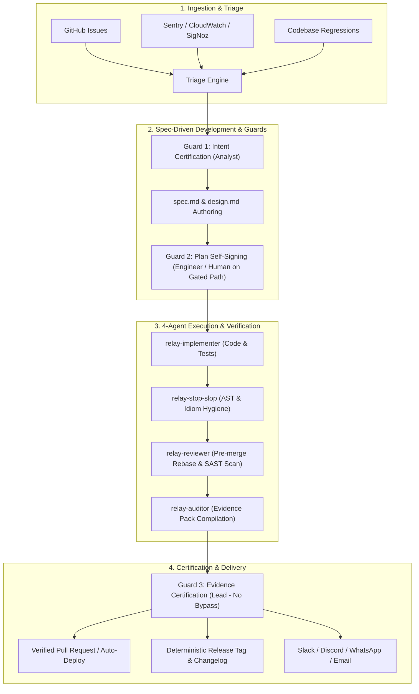
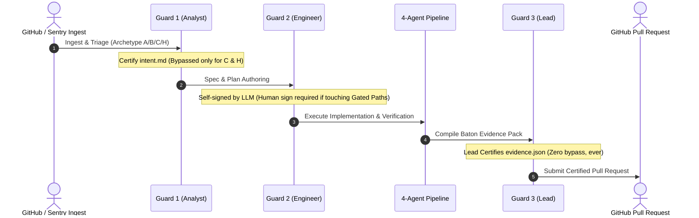

# Lodestar Product Features

> **The Autonomous, Spec-Driven Multi-Repo Software Factory for Vibecoders and Small Engineering Teams**

---

## Executive Overview

**Lodestar** is an enterprise-grade autonomous software engineering factory designed for solo builders ("vibecoders") and lean engineering teams. Rather than treating AI code generation as an unconstrained, chat-driven activity, Lodestar wraps multi-model autonomous agents in rigorous formal engineering methodologies: **Spec-Driven Development (Hanoi Rainbow)**, **Relay Guard 1/2/3 Quality Gates**, **Multi-Agent 4-Role Verification Pipelines**, **AST CodeGraph & Graft Code Intelligence**, and **Persistent Cross-Session Knowledge (LoadstoneNexus & Obsidian)**.



---

## 1. Spec-Driven Development (Hanoi Rainbow)

Lodestar never writes code directly from a prompt or raw issue description. Every task creates an isolated track workspace (`flight-deck/tracks/<track_id>/`) with a strict five-document lifecycle:

| Artifact | Purpose | Standard Contents |
| :--- | :--- | :--- |
| `intent.md` | Problem Statement & Boundaries | User requirements, expected behavior, non-goals, archetype classification. |
| `spec.md` | Interface & Domain Contracts | API signatures, schema models, type definitions, cross-repo impact assessments (`/impact-assesment`). |
| `design.md` | Architecture & Sequence | C4 architecture deltas (`/archify`), sequence flows, design rationale, trade-off analysis. |
| `plan.md` | Concrete Execution Plan | Task checklist, target files, test requirements, Guard 2 signature block. |
| `guard-evidence.md` | Certified Verification Pack | Full test transcripts (100% pass), SAST Opengrep scan outputs (0 CVEs), pre-merge rebase hashes, Lead signature. |

---

## 2. Relay Guard 1/2/3 Quality & Safety Gates

Quality control is enforced via structural gates adopted from the Relay methodology. These gates cannot be bypassed or configured away.



### Archetype-Based Routing
- **Archetype A (Greenfield / Major Feature)**: Full Guard 1 → Guard 2 → Pipeline → Guard 3.
- **Archetype B (Brownfield Feature / Refactor)**: Full Guard 1 → Guard 2 → Pipeline → Guard 3 with mandatory architecture impact analysis.
- **Archetype C (Fast-Path Bug Fix)**: Fast-tracked; skips Guard 1 and Guard 2 directly to implementation; strictly requires Guard 3 certification. Target cycle time: $\le 20\text{ minutes}$.
- **Archetype H (Hotfix / Incident)**: Triggered by telemetry alarms. Guard 1 and 2 bypassed for immediate remediation; requires Guard 3 sign-off prior to merge/deploy.

### Gated Path Protection
If a change touches security-sensitive paths (authentication, authorization, PII handling, cryptography, audit logging), the LLM is prohibited from self-signing Guard 2. An explicit human digital signature is required before worker execution begins.

---

## 3. Specialized 4-Agent Execution Pipeline

Within each track, execution is distributed across four distinct agent personas to prevent model hallucinations, code bloat, and regression risks:

1. **`relay-implementer`**: Writes minimal, targeted code changes accompanied by co-located unit and integration tests (`*.test.ts`).
2. **`relay-stop-slop`**: Scans the diff against AST rules and anti-patterns, eliminating speculative abstractions, unused dependencies, dead code, and verbose comments.
3. **`relay-reviewer`**: Validates pre-merge git rebase against the target branch, checks backward compatibility, and runs Opengrep SAST security analysis.
4. **`relay-auditor`**: Compiles test run logs, static analysis reports, and git diffs into the canonical Baton Evidence Package (`guard-evidence.md` + `evidence.json`).

---

## 4. Pluggable Multi-Model Engine

Lodestar supports heterogenous multi-vendor LLM deployment. Different models can be assigned to different agent personas or fleet workers based on cost, latency, and reasoning depth.

| Provider | Supported Models | Optimal Role | Adapter Implementation |
| :--- | :--- | :--- | :--- |
| **Anthropic** | Claude 3.5 Sonnet, Claude 3.7 Sonnet | `relay-implementer`, Lead Architect | [`anthropic-adapter.ts`](file:///Users/ragu/Code/lodestar/src/adapters/anthropic-adapter.ts) |
| **Google** | Gemini 2.5 Pro, Gemini 2.5 Flash | Fast triage, Large Context Codebase Analysis | [`gemini-adapter.ts`](file:///Users/ragu/Code/lodestar/src/adapters/gemini-adapter.ts) |
| **Moonshot (Kimi)**| Kimi K1.5 | Long-context Spec authoring & Code Review | [`kimi-adapter.ts`](file:///Users/ragu/Code/lodestar/src/adapters/kimi-adapter.ts) |
| **DeepSeek** | DeepSeek V3, DeepSeek R1 | Mathematical reasoning, complex algorithmic refactoring | [`deepseek-adapter.ts`](file:///Users/ragu/Code/lodestar/src/adapters/deepseek-adapter.ts) |
| **OpenAI** | GPT-4o, o3-mini | Cross-language translation, fallback review | [`openai-adapter.ts`](file:///Users/ragu/Code/lodestar/src/adapters/openai-adapter.ts) |

---

## 5. Intelligent Rate-Limit Sentinel & Session Continuity

Unlike standard scripts that crash on HTTP 429 quota exhaustion, Lodestar incorporates a resilient **Rate-Limit Sentinel**:
- **Per-Agent Quota Tracking**: Quota windows are tracked independently per model provider.
- **Durable Hold Schedule**: Active task state and session context are persisted to the instance-local SQLite Fleet DB.
- **Graceful Sleep & Auto-Resume**: The worker pauses execution, calculates exact `resume_at` backoff (defaulting to +6 hours if provider headers omit reset times), and resumes without losing work tree progress.
- **Survives Process Restarts**: Scheduled hold states remain active across systemd service restarts or node reboots.

---

## 6. Dual Pluggable Knowledge Backends

Lodestar maintains long-term project knowledge and decision journals without vendor lock-in. Both backends implement the unified [`memory-interface.ts`](file:///Users/ragu/Code/lodestar/src/core/interfaces/memory-interface.ts) contract:

- **LoadstoneNexus MCP (Default)**: High-speed local MCP server storing markdown-backed knowledge graphs, architectural decisions, and living documentation with SQLite indexing.
- **Obsidian REST Bridge**: Direct integration with existing Obsidian knowledge vaults via local REST API, allowing teams to explore agent decisions within Obsidian graph views.

---

## 7. Local Semantic CodeGraph & Graft Code Intelligence

To prevent token context bloat and keep large repository maps off remote networks, Lodestar uses local-first code analysis:
- **CodeGraph**: Builds local AST symbol tables, caller/callee trees, and cross-file reference graphs.
- **Graft MCP**: Local stdio MCP tool providing distilled module boundaries, file skeletons, and public API signatures directly into agent reasoning without reading entire files.

---

## 8. Multi-Worker Fleet Supervisor

Lodestar runs as a supervised process control plane managing a fleet of dedicated worker plane processes:
- **Git Worktree Isolation**: Each track runs inside an isolated `.worktrees/<track_id>/` worktree, preventing git lock collisions.
- **Process Health Monitoring**: Continuous tracking of PID, RSS memory consumption, CPU utilization, and worker heartbeats.
- **Auto-Healing**: Automatic respawn and recovery of crashed worker processes.
- **Dynamic Job Assignment**: Workers can be dynamically designated as **Issue Monitor**, **Incident / Log Monitor**, **Codebase Monitor**, or **Instrumentation Campaign**.

---

## 9. 16-Screen Live Operations Dashboard

A lightning-fast, server-rendered Bun web application with real-time Server-Sent Events (SSE) updates:

```
┌────────────────────────────────────────────────────────────────────────┐
│ Lodestar Live Operations Control Center                                │
├───────────────┬────────────────────────────────────────────────────────┤
│ Navigation    │ Live Status                                            │
│ • Stats       │ Total Active Tracks: 4      Fleet Health: 100% Nominal │
│ • Pipeline    │ ────────────────────────────────────────────────────── │
│ • Fleet       │ Active Pipeline View:                                  │
│ • Knowledge   │ [Issue #142] -> Guard 1 (Passed) -> Build -> Guard 3   │
│ • History     │ [Sentry-99]  -> Archetype H -> Fast Path (In-Flight)   │
│ • Releases    │ ────────────────────────────────────────────────────── │
│ • Monitor     │ Token Spend Today: $14.20    Cycle Time Avg: 18.4m     │
└───────────────┴────────────────────────────────────────────────────────┘
```

The 16 operational views include:
1. **My Stats**: Personal developer velocity and token consumption.
2. **Per-Repo Stats**: Aggregated repository-level cost and throughput metrics.
3. **Relay Pipeline & Guard Control**: Real-time 6-stage lifecycle & digital signing gates.
4. **My Fleet**: Named worker process monitoring and resource metrics.
5. **Agent Supervisor**: Worker stdout/stderr streaming and manual process controls.
6. **AMP Mesh**: Peer agent communication network and messaging streams.
7. **Gateways**: Status of Slack, Discord, WhatsApp, and SMTP integrations.
8. **CodeGraph & Graft Explorer**: Interactive AST symbol hierarchy browser.
9. **LoadstoneNexus / Obsidian Memory**: Living documentation, branch recall, and decision journal.
10. **Guard Document Browser**: Visual inspector for `intent.md`, `spec.md`, and evidence files.
11. **Run History**: Complete historical record of resolved tracks and PR links.
12. **Savings & ROI Ledger**: Computed developer hours saved versus LLM token expenditures.
13. **Release Tracker**: Deterministic release tags and changelog archive.
14. **Create Release**: One-click deterministic release tag generation.
15. **Agents Log**: Consolidated cross-agent audit logs.
16. **Monitor Setup & Campaigns**: Observability hooks and multi-repo campaign controls.

---

## 10. Deterministic Release Tracker & Tagging

Lodestar eliminates manual release tagging errors through an immutable release engine:
- **Format**: `dd-mm-yyyy-<short commit hash>` (e.g., `11-09-2026-a1b2c3d`).
- **Automatic Changelog Generation**: Automatically generates `change-log-<tag>.md` by aggregating all certified Guard 3 track summaries merged since the previous tag.
- **Git Native**: Tags and changelogs are committed and pushed directly to the remote repository.

---

## 11. Multi-Channel Alerting & Gateway Integration

Stay informed without leaving your team's communication tools:
- **Slack**: Rich webhook cards with one-click links to Guard documents and PRs.
- **Discord**: Channel notifications with role mentions on required human signatures.
- **WhatsApp**: Broadcast list alerts for critical production incidents (Archetype H).
- **Email (SMTP)**: Formal audit summaries delivered directly to designated lead reviewers.

---

## 12. Real-Time Metrics & Auto-Rollback Engine

Lodestar calculates mathematical performance metrics derived from immutable event-bus timestamps:
- **Cycle Time ($T_{\text{cycle}}$)**: End-to-end duration from issue ingestion to verified PR merge.
- **Evidence Completeness Score ($E_{\text{score}}$)**: 5-point verification score enforcing 100% test pass rates and zero SAST vulnerabilities.
- **Lead Sign-Off Velocity**: Measures review responsiveness.
- **Automated Health-Check Rollback**: When configured for autonomous deployment, post-deploy health check failures automatically trigger a git revert and open an Archetype H remediation track.
