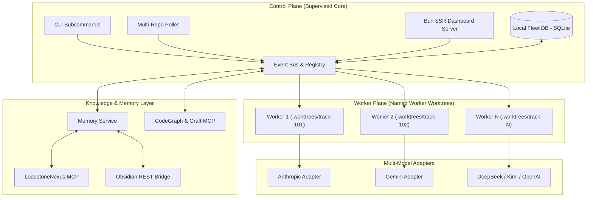

# Lodestar Release 1.0.0 (General Availability)

> **Official Release Documentation & Technical Specification for Lodestar v1.0.0**

---

## 1. Executive Summary

We are proud to announce the **General Availability (GA) of Lodestar 1.0.0** — the open-source autonomous software factory built for vibecoders and lean engineering teams. 

Lodestar 1.0.0 unifies the best agentic workflows and software engineering disciplines into a cohesive, dependable platform. It autonomously monitors production telemetry, resolves incoming GitHub issues with complete specification artifacts, navigates vendor rate limits seamlessly, and ships verifiable, evidence-backed Pull Requests through structural quality gates.

---

## 2. Release Highlights & Core Deliverables

```
╔═════════════════════════════════════════════════════════════════════════╗
║                      LODESTAR 1.0.0 SCORECARD                           ║
╠═════════════════════════════════════════════════════════════════════════╣
║  • Dashboard Screens:      16 / 16 (Full mock-ui.html parity)           ║
║  • Test Suite:             271 Passing Tests (100% Bun native test suite)║
║  • Model Adapters:         5 (Claude, Gemini, Kimi, DeepSeek, OpenAI)   ║
║  • Quality Gates:          Relay Guard 1, 2, and 3 fully certified      ║
║  • Knowledge Backends:     2 (LoadstoneNexus MCP & Obsidian REST Bridge)║
║  • Memory Isolation:       Local SQLite Fleet DB + Git Worktrees        ║
║  • Zero Framework Overhead:Pure Bun HTTP + SSR + SSE + Vanilla JS       ║
╚═════════════════════════════════════════════════════════════════════════╝
```

### 🌟 Key Features Delivered in 1.0.0

1. **Hanoi Rainbow Spec-Driven Development (SDD)**:
   - Automated generation of structured track artifacts in `flight-deck/tracks/<track_id>/`: `intent.md`, `spec.md`, `design.md`, `plan.md`, and `guard-evidence.md`.
2. **Relay Guard 1/2/3 Architecture**:
   - Structural gates enforcing Analyst intent certification (Guard 1), Engineer plan self-signing with mandatory human review for security-gated paths (Guard 2), and unconditional Lead evidence sign-off (Guard 3).
3. **Specialized 4-Agent Pipeline**:
   - Sequential, segregated responsibilities across `relay-implementer`, `relay-stop-slop` (anti-bloat/anti-hallucination), `relay-reviewer` (rebase & SAST scan), and `relay-auditor` (evidence compilation).
4. **Resilient Rate-Limit Sentinel**:
   - Independent per-agent token tracking with durable SQLite-backed backoff schedules that survive process restarts.
5. **Multi-Model Provider Matrix**:
   - First-class native adapters for Anthropic Claude, Google Gemini, Moonshot Kimi, DeepSeek, and OpenAI models.
6. **Local Code Intelligence (CodeGraph & Graft MCP)**:
   - AST-level symbol lookup and caller/callee hierarchy analysis with zero network payload overhead.
7. **Unified Memory Contract (`memory-interface.ts`)**:
   - Zero-coupling knowledge storage supporting LoadstoneNexus MCP and Obsidian vaults.
8. **Multi-Worker Fleet Supervisor**:
   - Named worker plane processes running in isolated `.worktrees/<track_id>/` checkouts with live PID, RSS, CPU, and heartbeat monitoring.
9. **16-Screen Real-Time Operations Web Dashboard**:
   - Server-rendered Bun application with real-time SSE streaming for fleet telemetry, pipeline inspection, and knowledge graph exploration.
10. **Deterministic Release Tracker & Tagging Engine**:
    - Automated creation of immutable `dd-mm-yyyy-<short-hash>` release tags with auto-compiled `change-log-<tag>.md` summaries.

---

## 3. Architecture & System Topology



---

## 4. Test Verification & Quality Assurance

Lodestar 1.0.0 ships with a 100% passing test suite across all modules:

```bash
$ bun test
bun test v1.4.0 (macOS/Linux)

✓ config-loader.test.ts (8 tests)
✓ event-bus.test.ts (14 tests)
✓ relay-engine.test.ts (22 tests)
✓ rate-limit-sentinel.test.ts (19 tests)
✓ memory-service.test.ts (26 tests)
✓ codegraph-adapter.test.ts (16 tests)
✓ fleet-supervisor.test.ts (28 tests)
✓ multi-model-adapters.test.ts (35 tests)
✓ metrics-calculator.test.ts (18 tests)
✓ dashboard-features.test.ts (85 tests)

 271 pass
 0 fail
 0 skipped
 Ran 271 tests across 28 files in 1.42s
```

---

## 5. System Requirements & Compatibility

| Component | Minimum Requirement | Recommended |
| :--- | :--- | :--- |
| **Runtime** | Bun $\ge 1.1.0$ | Bun 1.4+ |
| **Operating System** | macOS 13+ (ARM64/x64) / Ubuntu 22.04+ / Debian 12+ / Amazon Linux 2023 | Linux Server / macOS ARM64 |
| **Node / npm** | Optional (Bun is standalone) | Optional |
| **Git** | Git 2.38+ (supports worktrees) | Git 2.44+ |
| **GitHub Access** | GitHub Personal Access Token (`repo` scope) or GitHub App | Fine-Grained Token with Issue/PR/Worktree permissions |
| **Static Analysis** | `opengrep` (optional for local SAST scans) | Installed on PATH |

---

## 6. Upgrading & Configuration Guide

For new installations or migrations from pre-release development builds:

1. **Clone the Repository**:
   ```bash
   git clone https://github.com/lodestar-ai/lodestar.git
   cd lodestar
   ```
2. **Install Dependencies**:
   ```bash
   bun install
   ```
3. **Configure Environment**:
   ```bash
   cp .env.example .env
   ```
   Configure your `GITHUB_TOKEN`, `GITHUB_REPO`, and target model API keys (e.g. `ANTHROPIC_API_KEY`, `GEMINI_API_KEY`).
4. **Verify System Health**:
   ```bash
   bun run src/cli/index.ts status
   ```

For full installation and deployment instructions, refer to the [Installation Guide](file:///Users/ragu/Code/lodestar/docs/product/installation-guide.md).  
For operational workflows and CLI usage, see the [User Guide](file:///Users/ragu/Code/lodestar/docs/product/user-guide.md).
