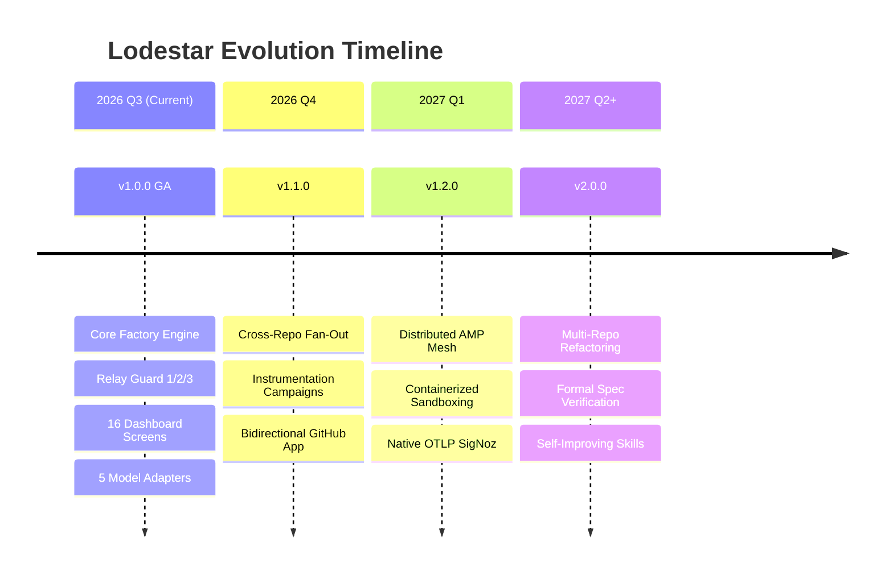
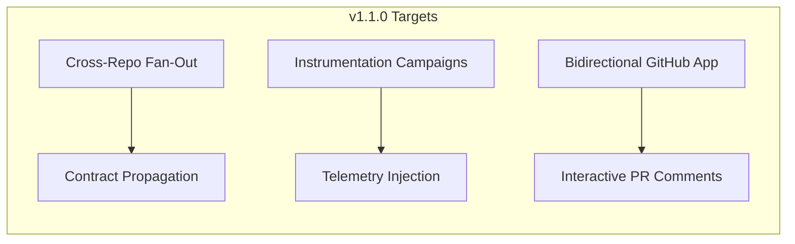

# Lodestar Product Roadmap

> **Strategic Vision, Milestone Releases, and Long-Term Evolution of the Autonomous Software Factory**

---

## 1. Vision & Strategic Focus

Lodestar's overarching mission is to transform software engineering for solo vibecoders and lean product teams. By establishing deterministic quality controls, multi-agent specialization, and local code intelligence, Lodestar enables a single engineer to safely manage, monitor, and evolve dozens of production repositories with enterprise-grade reliability.



---

## 2. Release Milestones & Feature Roadmap

### 🏁 Version 1.0.0 (Current GA Release) — Core Autonomous Factory
**Theme**: *Production-Ready Spec-Driven Autonomous Development & Relay Guard Certification*

- [x] **Relay Guard 1/2/3 Engine**: Structural quality gates with immutable Baton evidence verification.
- [x] **Hanoi Rainbow SDD**: Automated generation of `intent.md`, `spec.md`, `design.md`, and `plan.md`.
- [x] **4-Agent Pipeline**: Specialized execution across `implementer`, `stop-slop`, `reviewer`, and `auditor`.
- [x] **Multi-Model Support**: Production adapters for Claude (3.5/3.7), Gemini (2.5), Kimi (K1.5), DeepSeek (V3/R1), and OpenAI (GPT-4o/o3-mini).
- [x] **Dual Knowledge Backends**: LoadstoneNexus MCP and Obsidian REST Bridge behind a unified `memory-interface.ts`.
- [x] **Local Code Intelligence**: AST symbol graphs via CodeGraph and zero-network repo mapping via Graft MCP.
- [x] **Resilient Rate-Limit Sentinel**: Quota tracking and SQLite-backed durable hold schedules for HTTP 429 backoff.
- [x] **Process Fleet Supervisor**: Worker plane supervision, heartbeat checks, and auto-recovery.
- [x] **16-Screen Live Operations Dashboard**: Server-rendered Bun dashboard with real-time SSE stream.
- [x] **Deterministic Release Tracker**: Auto-generated `dd-mm-yyyy-<hash>` tags and compiled changelogs.
- [x] **Multi-Gateway Alerts**: Slack, Discord, WhatsApp, and SMTP integrations.

---

### 🚀 Version 1.1.0 (Q4 2026) — Multi-Repo Orchestration & Observability Campaigns
**Theme**: *Cross-Repository Dependency Fan-Out & Autonomous Fleet Telemetry*



- **Cross-Repo Fan-Out Engine**:
  - Automatically detect upstream API/contract changes and propagate child tracks to dependent repositories.
  - Sequenced PR creation with cross-repository traceability and dependency ordering.
- **Bulk Instrumentation Campaigns**:
  - Live execution of telemetry rollout campaigns across multi-repo clusters.
  - Automated injection of OpenTelemetry/SigNoz trace spans and error handlers with Bulk Guard 3 certification.
- **Interactive GitHub App & Webhook Gateway**:
  - Bidirectional conversation inside PR and Issue comment threads (e.g., `@lodestar approve guard-2`).
  - Automated review comment remediation and test failure re-runs directly from GitHub webhooks.
- **Dynamic Worker Balancing**:
  - Automatic re-allocation of idle workers to backlogged repositories based on issue priority.

---

### 🌐 Version 1.2.0 (Q1 2027) — Distributed Fleet & Containerized Isolation
**Theme**: *Multi-Host AMP Mesh Scale-Out and Secure Test Sandboxing*

- **Multi-Machine AMP Mesh Scale-Out**:
  - Peer-to-peer Agent Messaging Protocol (AMP) networking across multiple EC2/bare-metal worker instances.
  - Central control plane coordinating distributed worker planes across cloud regions.
- **Secure Containerized Sandbox Execution**:
  - Ephemeral Firecracker microVM or rootless Docker sandboxes for running untrusted third-party code and unit tests.
  - Hardware-isolated workspace execution preventing system compromise during autonomous builds.
- **Native OTLP/HTTP SigNoz Tracing Exporter**:
  - Zero-dependency OTLP JSON trace exporter streaming agent token usage, execution spans, and tool latency directly into SigNoz APM.
- **Autonomous Flaky Test Detection**:
  - Statistical re-execution engine identifying and quarantining non-deterministic test suites.

---

### 🔮 Version 2.0.0 (Q2 2027+) — Autonomous System Architecture & Self-Evolution
**Theme**: *Architectural Synthesis and Self-Improving Agentic Cognition*

- **Multi-Repo Architectural Refactoring Synthesizer**:
  - Autonomous migration of shared libraries, monolith-to-microservice decomposition, and framework upgrades across entire organizational codebases.
- **Self-Improving Memory & Skill Optimization**:
  - Automatic extraction of successful debugging strategies into reusable agent skills.
  - Negative constraint learning: blocked Guard 3 reviews automatically feed regression prevention rules into future `spec.md` templates.
- **Formal Verification & Type Synthesis**:
  - Integration with formal specification and model checking tools (TLA+, Z3 theorem prover) for high-assurance systems.

---

## 3. Release Cadence & Governance

| Release Type | Frequency | SemVer Rule | Description |
| :--- | :--- | :--- | :--- |
| **Patch Release** | Weekly / On-Demand | `1.0.x` | Bug fixes, model prompt adjustments, adapter stability patches. |
| **Minor Release** | Monthly | `1.x.0` | New dashboard screens, additional model providers, gateway enhancements, backward-compatible API additions. |
| **Major Release** | Bi-Annually | `x.0.0` | Architectural overhauls, contract migrations, distributed protocol enhancements. |

---

## 4. Feature Request & Contribution Prioritization Matrix

```
       HIGH IMPACT
            ▲
            │  [Cross-Repo Fan-Out]        [Distributed AMP Mesh]
            │  [Interactive GitHub App]    [Containerized Sandbox]
            │
            │  [New Model Adapters]        [Custom Dashboard Themes]
            │  [Webhooks / WebUI Polishing][Minor CLI Aliases]
            └──────────────────────────────────────────────────►
          LOW EFFORT                                     HIGH EFFORT
```

1. **P0 (Critical / Near-Term)**: Features that expand autonomous reliability (Cross-Repo Fan-Out, GitHub App).
2. **P1 (High / Scale-Out)**: Features that enable team growth and multi-server fleets (Distributed AMP, Sandboxing).
3. **P2 (Medium / Polish)**: New UI modules, CLI developer experience, additional notification gateways.
