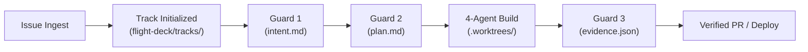

# Lodestar User Guide

> **The Complete Operational Guide for Vibecoders and Engineering Teams**

---

## 1. Introduction & Core Concepts

Lodestar automates issue resolution, incident management, and regression prevention through a structured lifecycle. Before running commands, familiarize yourself with these four fundamental concepts:

- **Track**: An isolated task execution instance representing a single issue, incident, or campaign. Each track receives a dedicated directory (`flight-deck/tracks/<track_id>/`) and Git worktree (`.worktrees/<track_id>/`).
- **Flight Deck**: The working document vault where Hanoi Rainbow specification artifacts are created and certified.
- **Baton**: The verifiable evidence package (`guard-evidence.md` and `evidence.json`) passed between pipeline agents.
- **Guards**: Non-bypassable quality checkpoints (Guard 1, Guard 2, Guard 3) governing whether a track can proceed to the next phase.



---

## 2. CLI Command Reference

All Lodestar operations are accessible via the unified Bun CLI at `src/cli/index.ts`.

### 2.1 Resolve a Single GitHub Issue
Resolve an issue end-to-end with automated spec authoring, code implementation, test verification, and PR submission:

```bash
bun run src/cli/index.ts run --issue <NUMBER> --repo <OWNER/REPO> [--provider claude|gemini|kimi|deepseek|openai]
```

**Options**:
- `--issue <number>` *(Required)*: The GitHub issue number to resolve.
- `--repo <owner/repo>` *(Required)*: Target GitHub repository (e.g. `apache/casbin-gateway`).
- `--provider <model>` *(Optional)*: Override the primary model provider for this run.

---

### 2.2 Continuous Autonomous Daemon
Launch a continuous background poller that monitors configured repositories for issues labeled with your trigger tag (e.g. `agent-todo`):

```bash
bun run src/cli/index.ts daemon --interval 60 --label agent-todo
```

**Options**:
- `--interval <seconds>`: Polling frequency in seconds (default: `60`).
- `--label <string>`: GitHub issue label filter (default: reads `ISSUE_LABEL_FILTER` from `.env`).
- `--repo <owner/repo>`: Optional override for `GITHUB_REPO`.

---

### 2.3 Start the Live Operations Dashboard
Launch the server-rendered web dashboard to monitor active tracks, worker fleet health, and token expenses:

```bash
bun run src/cli/index.ts dashboard --port 3000
```
Open your browser to `http://localhost:3000`.

---

### 2.4 Index Repository Knowledge Base
Generate AST symbol graphs and module skeletons for a repository and index them into LoadstoneNexus or Obsidian:

```bash
bun run src/cli/index.ts init-knowledge [--repo <path-or-name>]
```

---

### 2.5 Health & Rate-Limit Diagnostics
Inspect system configuration, worker process health, and active rate-limit hold schedules:

```bash
# Snapshot of config, models, and worker status
bun run src/cli/index.ts status

# Test rate-limit backoff and recovery logic without real 429 errors
bun run src/cli/index.ts sentinel-test
```

---

## 3. Working with Tracks & The Flight Deck

When a track is opened, Lodestar creates a designated workspace in `flight-deck/tracks/<track_id>/`:

```
flight-deck/tracks/track-2026-09-11-issue-42/
├── intent.md          # PRD, requirements, Archetype classification (Guard 1)
├── spec.md            # Interfaces, type models, impact assessment
├── design.md          # Sequence flow and C4 architecture deltas
├── plan.md            # Step-by-step tasks & Guard 2 signature block
└── guard-evidence.md  # Test outputs, SAST scans, and Guard 3 Lead certification
```

### Inspecting Track Status
You can view any active or historical track directly in the web dashboard under **Guard Document Browser** or **Relay Pipeline**, or by reading the markdown files directly.

---

## 4. Relay Guard 1/2/3 Operational Workflows

### Guard 1: Intent Certification (Analyst)
- **What it verifies**: Problem definition and requirements boundaries.
- **Workflow**:
  - In `TEAM_MODE=solo`, the agent certifies intent automatically.
  - In `TEAM_MODE=team`, the Analyst reviews `intent.md` and adds a digital signature block.
  - *Archetype C (Bug fix)* and *Archetype H (Hotfix)* bypass Guard 1 to minimize latency.

### Guard 2: Plan Approval (Engineer)
- **What it verifies**: Step-by-step implementation tasks and target file list.
- **Workflow**:
  - The Engineer agent self-signs `plan.md` automatically under standard paths.
  - **Gated Paths**: If the change touches authentication, authorization, PII, or audit logging, Lodestar halts and alerts the team via Slack/Discord for a human signature.

### Guard 3: Lead Evidence Certification (Lead)
- **What it verifies**: Baton Evidence Package (`guard-evidence.md` + `evidence.json`).
- **Workflow**:
  - Requires 100% test pass rate, 0 Opengrep SAST security alerts, and clean pre-merge git rebase.
  - **Strict Rule**: Guard 3 can *never* be bypassed by any archetype or configuration mode. Once signed, the PR is submitted to GitHub.

---

## 5. Operating the Web Dashboard

The Lodestar Dashboard runs on Bun with real-time SSE updates across 16 screens:

```
┌────────────────────────────────────────────────────────────────────────┐
│  LODESTAR DASHBOARD SCREEN DIRECTORY                                  │
├────────────────────────────────────────────────────────────────────────┤
│  [1] My Stats             - Personal token spend and cycle time        │
│  [2] Per-Repo Stats       - Multi-repo token cost and resolution counts│
│  [3] Relay Pipeline       - Live 6-stage track state machine & signing │
│  [4] My Fleet             - Worker table (PID, CPU, RSS memory)        │
│  [5] Agent Supervisor     - Real-time stdout/stderr log streaming     │
│  [6] AMP Mesh             - Inter-agent message and peer feed          │
│  [7] Gateways             - Health of Slack/Discord/WhatsApp/SMTP      │
│  [8] CodeGraph & Graft    - AST symbol trees and repo map viewer       │
│  [9] Memory Explorer      - Decision journal and branch recall         │
│  [10] Guard Doc Browser   - Live viewer for intent/spec/design/plan    │
│  [11] Run History         - Historical audit trail of all tracks       │
│  [12] Savings & ROI       - Financial ROI ledger vs developer hours    │
│  [13] Release Tracker     - Release history and compiled changelogs    │
│  [14] Create Release      - Instant deterministic release tag creation │
│  [15] Agents Log          - Centralized structured agent log stream    │
│  [16] Monitor Setup       - Telemetry alarms & campaign controllers    │
└────────────────────────────────────────────────────────────────────────┘
```

### Live Fleet Management
Navigate to **My Fleet** to view named workers. You can dynamically adjust worker model providers (e.g. switch a worker from Claude to Gemini) or reassign job roles without restarting the daemon.

---

## 6. Cutting Releases

Lodestar enforces deterministic, reproducible releases:

1. Navigate to **Create Release** in the dashboard (or trigger via API).
2. Select target repository.
3. Lodestar generates a deterministic tag: `dd-mm-yyyy-<short commit hash>` (e.g. `11-09-2026-f4a19b2`).
4. Lodestar gathers all certified Guard 3 track records merged since the previous release and compiles `change-log-<tag>.md`.
5. The commit, tag, and changelog are pushed directly to GitHub.

---

## 7. Rate-Limit Handling & Diagnostics

When an LLM provider returns an HTTP 429 rate-limit response:
1. Lodestar extracts the reset header or defaults to a 6-hour backoff.
2. The active track state is safely saved.
3. A hold schedule is written to the local SQLite Fleet DB (`rate_limit_holds`).
4. The dashboard displays a live countdown timer next to the worker.
5. Once the timer expires, the worker automatically resumes where it left off.

To inspect active holds:
```bash
bun run src/cli/index.ts status
```

---

## 8. Multi-Channel Alerting

Lodestar dispatches real-time event updates to configured communication channels:
- **Track Started**: Notifies channel of issue ingestion and assigned archetype.
- **Human Signature Required**: Alerts Lead/Analyst with a direct link when Guard 2 touches a gated path.
- **PR Submitted**: Posts final PR link, summary of changes, and evidence scorecard.
- **Incident Alarm (Archetype H)**: Triggers high-priority broadcasts across WhatsApp and Slack.
