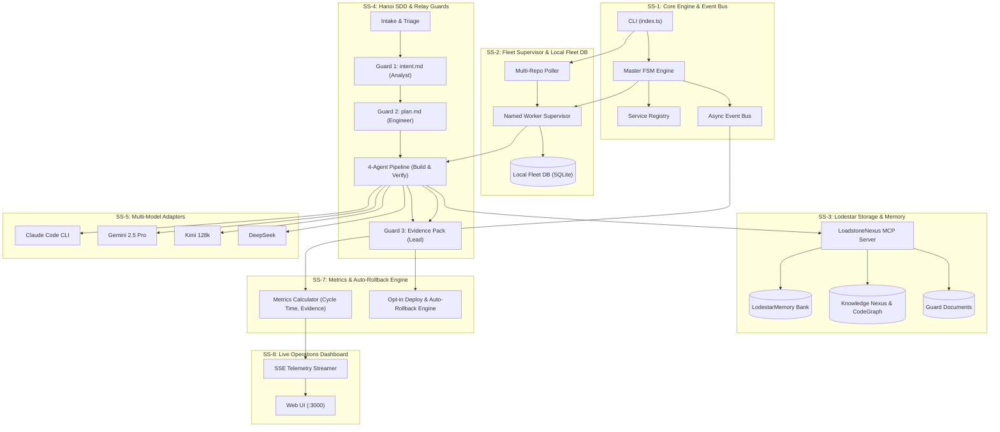
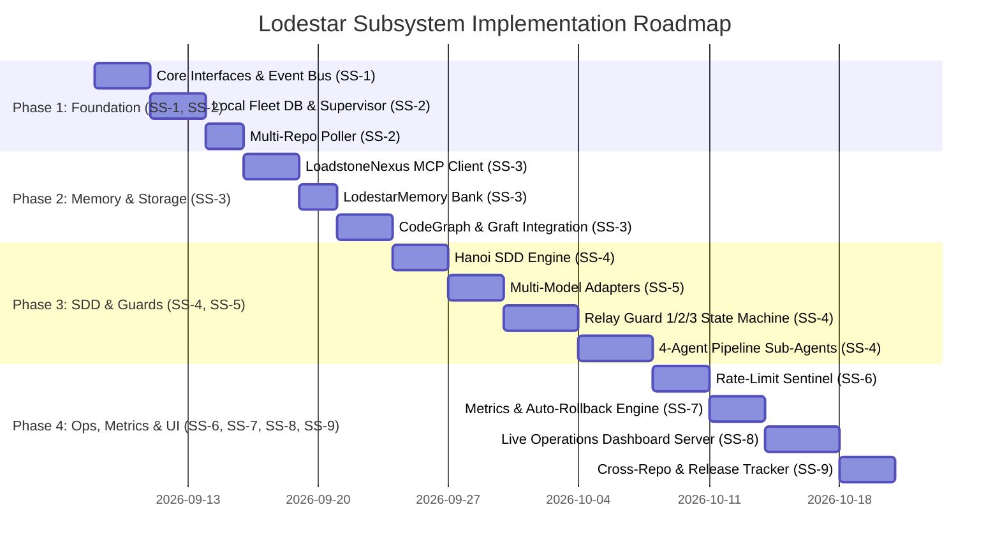

# Lodestar: Subsystem Architecture & Changes Required Specification

> **Comprehensive breakdown of every Lodestar subsystem, defining architectural responsibilities, data flow contracts, interface boundaries, and the concrete changes required to implement each component from baseline to production.**

---

## 1. Subsystem Architecture Matrix

| # | Subsystem | Primary Directory | Core Responsibility | Invariant / Boundary Rule |
|---|---|---|---|---|
| **SS-1** | **Core Engine, Registry & Event Bus** | `src/core/`, `src/cli/` | Finite State Machine orchestration, dynamic plugin registry, asynchronous event bus dispatch, CLI subcommands. | Pure abstraction layer; zero direct external dependencies or database operations. |
| **SS-2** | **Multi-Repo Poller & Fleet Supervisor** | `src/services/agent-service/` | Multi-repository issue polling, process spawning, RSS/PID monitoring, local SQLite session/hold scheduling. | Instance-local operational state only (`fleet-db.ts`); never writes local bookkeeping to central knowledge storage. |
| **SS-3** | **Lodestar Central Storage & Memory** | `src/services/memory-service/`, `src/plugins/memory/` | LodestarMemory banks, CodeGraph AST caches, Graft repository maps, Hanoi SDD Guard documents. | Pluggable backend behind `memory-interface.ts` (LoadstoneNexus MCP / Obsidian REST). All access via MCP tools. |
| **SS-4** | **Hanoi Rainbow SDD & Relay Guard System** | `src/services/planning-service/`, `src/plugins/agents/` | 6-Stage Relay lifecycle (`intake` → `shape` → `plan` → `build` → `verify` → `ship`), Guard 1/2/3 enforcement, 4-agent pipeline. | Guard 1/3 structural enforcement (zero bypass on Guard 3); Guard 2 auto-self-signed unless on gated paths (auth/PII). |
| **SS-5** | **Multi-Model Adapter Factory** | `src/adapters/` | Unified async streaming execution across Claude Code CLI, Google Gemini 2.5 Pro, Moonshot Kimi 128k, and DeepSeek. | Strict adherence to `agent-interface.ts` (`dispatch(task, sessionId) -> AsyncIterable<AgentEvent>`). |
| **SS-6** | **Usage, Quota & Rate-Limit Sentinel** | `src/services/agent-service/supervisor.ts`, `fleet-db.ts` | Per-agent token accounting, real-time rate-limit error pattern detection, persistent hold scheduling with auto-resume. | Independent per-worker quotas; rate limits never freeze unaffected agents; survived through process restarts. |
| **SS-7** | **CI/CD Verification, Metrics & Rollback Engine** | `src/services/monitor-service/` | Test execution, Cycle Time calculation, 5-artifact Evidence Pack validation, opt-in post-Guard-3 deployment, 30m auto-rollback. | Automated rollback on $3\times$ probe failure or error rate spike $>3\sigma$; dispatches Sev-0/1 alerts. |
| **SS-8** | **Live Operations Dashboard & SSE Telemetry** | `src/dashboard/` | 13-screen responsive Web UI on `:3000`, live SSE metric streaming, terminal logs, interactive job controls, Guard approvals. | Strict alignment with `mock-ui.html` executable specification; vanilla HTML/CSS/JS with zero bulky frameworks. |
| **SS-9** | **Cross-Repo Fan-Out & Release Tracker** | `src/plugins/tools/`, `src/features/release-tracker/` | AST API endpoint discovery, sequential multi-repo child track dispatch, `dd-mm-yyyy-<SHA>` git release tagging & changelog generation. | Sequential execution for cross-repo contract stability; immutable changelog and tag naming conventions. |

---

## 2. Deep Dive: Subsystem Specifications & Changes Required

---

### Subsystem 1: Core Engine, Registry & Event Bus (`src/core/`, `src/cli/`)

#### 1.1 Architecture & Role
The central nervous system of Lodestar. Coordinates component lifecycles, registers tool/agent/memory plugins, orchestrates the master Finite State Machine (FSM), and routes events across components via an in-memory asynchronous event bus.

#### 1.2 Interfaces & Contracts
- `src/core/interfaces/agent-interface.ts`: Defines `AgentAdapter`, `AgentTask`, `AgentEvent` (`token`, `tool_call`, `error`, `done`).
- `src/core/interfaces/tool-interface.ts`: Standardized MCP and local tool invocation contract.
- `src/core/interfaces/memory-interface.ts`: Universal storage contract (`persist_knowledge`, `retrieve_knowledge`, `persist_decision`, `persist_guard_document`, `retrieve_guard_document`).
- `src/core/event-bus.ts`: Typed event emitter broadcasting `track.opened`, `guard.certified`, `rate_limit.hit`, `deploy.rollback`, `metric.updated`.

#### 1.3 Changes Required from Baseline to Implementation
1. **[NEW]** Implement `src/core/interfaces/*.ts` formalizing strict contracts with zero leaf-node imports.
2. **[NEW]** Implement `src/core/registry.ts` with dependency injection, dynamic provider resolution, and hot-swappable plugins.
3. **[NEW]** Build `src/core/engine.ts` supporting Hanoi Rainbow state transitions, archetype triage routing (A, B, C, H), and gated path validation.
4. **[NEW]** Build `src/core/event-bus.ts` with async queueing, typed listeners, and subscriber filtering for SSE broadcasts.
5. **[NEW]** Build `src/cli/index.ts` with subcommands: `run`, `daemon`, `dashboard`, `init-knowledge`, `sentinel-test`, `status`.

---

### Subsystem 2: Multi-Repo Poller, Fleet Supervisor & Local Fleet DB (`src/services/agent-service/`)

#### 2.1 Architecture & Role
Manages distributed multi-repo execution and host-level process lifecycle. Polls GitHub for issues matching label criteria across repos, dispatches tracks to isolated worktrees, monitors child worker processes (PID, RSS memory, CPU, heartbeats), and persists operational state in an instance-local SQLite database.

#### 2.2 Local Fleet DB Schema (`bun:sqlite`)
- `workers`: `worker_id`, `name`, `model_provider`, `job_type`, `pid`, `rss_bytes`, `cpu_percent`, `heartbeat_at`, `status`.
- `tracks`: `track_id`, `repo`, `issue_number`, `archetype`, `stage`, `assigned_worker`, `worktree_path`, `started_at`, `updated_at`.
- `hold_schedules`: `id`, `worker_id`, `provider`, `model`, `held_at`, `resume_at`, `retry_count`, `active`.

#### 2.3 Changes Required
1. **[NEW]** Create `src/services/agent-service/fleet-db.ts` initializing the local SQLite schema with indexes and transaction safety.
2. **[NEW]** Implement `src/services/agent-service/supervisor.ts` to spawn named worker subprocesses (`lodestar worker --name <worker-id>`), monitor health every 5s, and auto-restart crashed workers.
3. **[NEW]** Implement `src/services/agent-service/multi-repo-poller.ts` handling `GITHUB_REPO` comma-separated list, rate-limit safe ETag polling, and issue queue dispatching.
4. **[NEW]** Implement worktree lifecycle manager in `src/plugins/tools/git-tool.ts` creating `.worktrees/<track_id>/` upon track start and cleaning up upon Guard 3 certification.

---

### Subsystem 3: Central Knowledge Intelligence, LodestarMemory & MCP Layer (`src/services/memory-service/`)

#### 3.1 Architecture & Role
Provides unified project intelligence across sessions, repositories, and agents. Abstracts storage backends so that all memory and Guard documents are accessible via standard MCP tool calls.

#### 3.2 Storage Layout (`$DATA_DIR/`)
- `knowledge/`: AST symbols, repo maps, architectural summaries (generated via CodeGraph and Graft).
- `memories/`: **LodestarMemory Bank** — persistent cross-session solution patterns, living documentation, and branch recall notes.
- `decisions/`: Decision journals capturing architectural rationale extracted during agent reasoning.
- `guards/`: Hanoi SDD artifacts (`intent.md`, `spec.md`, `design.md`, `plan.md`, `guard-evidence.md`, `evidence.json`).
- `dev-journal/{agent-name}/`: Full chronological logs emitted by named agents.

#### 3.3 Changes Required
1. **[NEW]** Implement `src/services/memory-service/memory-service.ts` implementing `memory-interface.ts` dispatching to active backend.
2. **[NEW]** Build `src/services/memory-service/loadstonenexus-backend.ts` supporting both local `stdio` MCP server and remote `http` MCP proxy.
3. **[NEW]** Build `src/services/memory-service/obsidian-backend.ts` wrapping Obsidian Local REST API for vault integration.
4. **[NEW]** Build `src/plugins/memory/graph-memory.ts` integrating `codegraph` CLI and Graft MCP stdio server.
5. **[NEW]** Build `src/plugins/memory/session-memory.ts` as the LodestarMemory decision journal and memory bank writer.

---

### Subsystem 4: Hanoi Rainbow SDD Engine & Relay Guard System (`src/services/planning-service/`, `src/plugins/agents/`)

#### 4.1 Architecture & Role
Executes Hanoi Rainbow Spec-Driven Development structured across Relay's 6-Stage Lifecycle with strict Guard 1/2/3 checkpoints.

#### 4.2 Relay 6-Stage Lifecycle Workflow
1. **Stage 1: Intake (`/intake-routing`)**: Assigns archetype (A, B, C, H), opens track in `flight-deck/tracks/<track_id>/`.
2. **Stage 2: Shape (`/grill-me` → `/define-requirements` → `/decompose-tasks`)**: Produces `intent.md` and `spec.md`. Gated by **Guard 1** (Analyst sign; bypassed only on C and declared H).
3. **Stage 3: Plan (`/flight-deck-plan` + `/archify`)**: Generates `design.md` and `plan.md`. Gated by **Guard 2** (Agent self-signs automatically; forced human approval on gated paths like auth/PII).
4. **Stage 4: Build (`relay-implementer` → `/tdd` → `/e2e-playwright` → `relay-stop-slop`)**: Implements code in isolated worktree; enforces passing tests and slop-free standards.
5. **Stage 5: Verify (`relay-reviewer` → `/sastanalysis`)**: Performs automated code review, security audits, and rebase verification.
6. **Stage 6: Ship (`relay-auditor` → `/verify-traceability`)**: Produces `guard-evidence.md` + `evidence.json`. Gated by **Guard 3** (Lead certification, 0% bypass).

#### 4.3 Changes Required
1. **[NEW]** Implement `src/services/planning-service/sdd-generator.ts` generating canonical markdown artifacts with SHA-256 headers.
2. **[NEW]** Implement `src/plugins/agents/watcher-agent.ts` (Intake & Triage), `reasoning-agent.ts` (Shape & Root Cause), `planning-agent.ts` (Plan & Task Decomposition), and `execution-agent.ts` (Build & Test).
3. **[NEW]** Implement the 4 Relay pipeline sub-agents in `src/plugins/agents/relay-pipeline.ts`:
   - `relay-implementer`: Iterative test-driven coder.
   - `relay-stop-slop`: Linter, code smell, and over-engineering detector.
   - `relay-reviewer`: Multi-pass diff reviewer and SAST validator.
   - `relay-auditor`: Evidence pack synthesizer and traceability verifier.
4. **[NEW]** Implement Gated Path detector checking diffs for auth, permissions, encryption, and PII markers.

---

### Subsystem 5: Multi-Model Adapter Factory (`src/adapters/`)

#### 5.1 Architecture & Role
Provides unified execution across diverse LLM backends with streaming event translation, token counting, and session resume capabilities.

#### 5.2 Supported Providers
- **Anthropic Claude Code (`anthropic-adapter.ts`)**: Headless CLI runner executing tasks in dedicated worktrees.
- **Google Gemini 2.5 Pro (`gemini-adapter.ts`)**: REST/SDK streaming client with multimodal context support.
- **Moonshot Kimi 128k (`kimi-adapter.ts`)**: Extended-context engine for huge repository call trees and legacy files.
- **DeepSeek (`deepseek-adapter.ts`)**: Reasoning and deep logic specialist.
- **OpenAI (`openai-adapter.ts`)**: OpenAI GPT models streaming client via OpenAI-compatible endpoint.

#### 5.3 Changes Required
1. **[NEW]** Build `src/adapters/openai-compatible-adapter.ts` handling streaming SSE chunks, token counting, and rate-limit detection.
2. **[NEW]** Implement `src/adapters/anthropic-adapter.ts` spawning `claude --print` headless child processes with session UUIDs.
3. **[NEW]** Implement `src/adapters/gemini-adapter.ts`, `kimi-adapter.ts`, `deepseek-adapter.ts`, and `openai-adapter.ts`.
4. **[NEW]** Support per-agent model assignment configured via `.env` (`AGENT_<N>_PROVIDER`) and live dashboard controls.

---

### Subsystem 6: Usage, Quota & Rate-Limit Sentinel Subsystem (`src/services/agent-service/supervisor.ts`, `fleet-db.ts`)

#### 6.1 Architecture & Role
Monitors token spend, cache hit rates, and quota exhaustion in real time. Prevents catastrophic API lockouts by putting affected workers into a paused state with persisted hold schedules in SQLite.

#### 6.2 Mechanics
- Detects HTTP 429, `rate_limit_exceeded`, `quota_exhausted`, and CLI token warnings.
- Parses reset window (or defaults to **now + 6 hours** if unspecified).
- Persists hold schedule in local `fleet-db.ts` (`Session State = paused_rate_limited`).
- Background poller checks SQLite every 30s and auto-resumes worker once `resume_at <= now()`.
- **Per-Agent Isolation**: Worker A hitting Claude rate limits does not block Worker B running Gemini or DeepSeek.

#### 6.3 Changes Required
1. **[NEW]** Implement error pattern matching parser for CLI outputs and API response headers in `src/services/agent-service/sentinel.ts`.
2. **[NEW]** Integrate hold schedule persistence in `src/services/agent-service/fleet-db.ts`.
3. **[NEW]** Implement auto-resume scheduler loop inside `supervisor.ts`.
4. **[NEW]** Emit `rate_limit.hit` and `rate_limit.resumed` events onto the `EventBus` for dashboard alerting.

---

### Subsystem 7: CI/CD Verification, Metrics & Rollback Engine (`src/services/monitor-service/`)

#### 7.1 Architecture & Role
Executes automated test/build commands, calculates core operational metrics, enforces evidence completeness, and orchestrates opt-in post-Guard-3 deployments with auto-rollback protection.

#### 7.2 Metrics & Rollback Logic (`src/services/monitor-service/metrics-calculator.ts`)
1. **Cycle Time ($T_{\text{cycle}}$)**:
   $$T_{\text{cycle}} = T_{\text{Guard3\_Signed}} - T_{\text{Intake\_Started}}$$
2. **Evidence Completeness Score ($E_{\text{score}}$)**:
   $$E_{\text{score}} = \sum_{i=1}^{5} w_i \cdot \mathbb{I}(\text{artifact}_i \text{ valid}), \quad w_i = 0.20 \quad (\text{Target: } 100\%)$$
3. **Rollback Trigger Conditions**:
   - $3\times$ consecutive health probe failures within 30m window.
   - P99 latency degradation $> 200\%$ compared to pre-deploy baseline.
   - HTTP 5xx error rate $> 1.0\%$ or $> 3\sigma$ standard deviations.
   - Action: Executes `git revert -m 1 HEAD`, redeploys baseline, dispatches Sev-0/1 alert to Slack/Discord.

#### 7.3 Changes Required
1. **[NEW]** Build `src/services/monitor-service/metrics-calculator.ts` with algorithms for cycle time, evidence validation, and rollback tracking.
2. **[NEW]** Build `src/services/monitor-service/ci-runner.ts` executing `bun test`, `npm test`, or custom test scripts in worktrees.
3. **[NEW]** Build `src/services/monitor-service/deployer.ts` parsing `flight-deck/workflow.md` for opt-in deployment commands and monitoring post-deploy health probes for 30 minutes.
4. **[NEW]** Build `src/services/monitor-service/gateway-notifier.ts` supporting Slack, Discord, WhatsApp, and Email alert webhooks.

---

### Subsystem 8: Live Operations Dashboard & SSE Telemetry (`src/dashboard/`)

#### 8.1 Architecture & Role
Delivers a high-density, real-time operations dashboard on port `:3000` adhering 1:1 with `mock-ui.html`. Provides complete fleet visibility, guard sign-off controls, memory browsing, and live terminal streaming.

#### 8.2 Screen Catalog Architecture
- **Screen 1: My stats**: 2x3 Relay lifecycle matrix with expandable connection/rule drawers, shipped tracks metrics (Lead-approved), cycle time breakdown, and lead sign-off velocity SLAs.
- **Screen 2: Relay Pipeline**: 6-stage operational pipeline stepper, active track checklist progress, and multi-repo campaign drawers.
- **Screen 3: My fleet**: Named agent workers, live RSS/PID stats, active model provider, and interactive job reassignment dropdowns.
- **Screen 4: Repos stats**: Multi-repo breakdown, issue velocity, and health scores.
- **Screen 5: Agents log**: Real-time terminal log viewer filtered by named worker.
- **Screen 6: Guard Documents**: Hanoi SDD document viewer (`intent.md`, `spec.md`, `plan.md`, `guard-evidence.md`, `evidence.json`) with cryptographic signature blocks and one-click Guard 1 / Guard 3 approval modals.
- **Screen 7: Run history & Releases**: Detailed historical runs, release tracker (`dd-mm-yyyy-<SHA>`), and changelog viewer.
- **Screens 8–13**: Memories (LodestarMemory bank), Knowledge Graph, Tokens, Spend, Campaigns, Settings.

#### 8.3 Changes Required
1. **[NEW]** Implement `src/dashboard/server.ts` using Bun's native HTTP server + SSE endpoint (`/api/telemetry/stream`).
2. **[NEW]** Implement static asset server and HTML templates in `src/dashboard/views/*.html` matching `mock-ui.html`.
3. **[NEW]** Implement vanilla JS client in `src/dashboard/public/app.js` with SSE auto-reconnect, screen switching, and tab state preservation.
4. **[NEW]** Implement REST API endpoints for Guard approvals (`POST /api/guards/sign`), job reassignment (`POST /api/fleet/reassign`), and release creation (`POST /api/releases/create`).

---

### Subsystem 9: Cross-Repo Fan-Out, Release Tagging & Changelog Subsystem (`src/plugins/tools/git-tool.ts`)

#### 9.1 Architecture & Role
Handles complex multi-repository modifications and automated release management. Identifies cross-repo dependencies via AST searches in central knowledge, executes sequential child tracks, and cuts immutable git release tags with accompanying changelogs.

#### 9.2 Release & Tagging Rules
- **Tag Format**: `dd-mm-yyyy-<short commit hash>` (e.g. `07-09-2026-a1b2c3d`).
- **Changelog Location**: `changelogs/change-log-<tag>.md` committed directly with the release tag.
- **Traceability**: Groups resolved tracks by job type (Incidents, Features, Bug Fixes, Instrumentation).

#### 9.3 Changes Required
1. **[NEW]** Add AST cross-repo scanning functions in `src/plugins/tools/git-tool.ts` querying LoadstoneNexus stored repo maps.
2. **[NEW]** Build `src/features/cross-repo/fan-out-controller.ts` creating sequential child tracks with parent cross-referencing.
3. **[NEW]** Build `src/features/release-tracker/release-manager.ts` automating changelog compilation and git tag creation.

---

## 3. Implementation Phasing & Dependency Roadmap

---

## 4. Verification & DoD Checklist for Subsystems

- [ ] **SS-1**: Event bus broadcasts typed events without leaking memory; CLI subcommands execute correctly.
- [ ] **SS-2**: Named worker processes auto-restart on crash; hold schedules in `fleet-db.ts` survive daemon restart.
- [ ] **SS-3**: LodestarMemory and Guard documents successfully write and retrieve via LoadstoneNexus MCP.
- [ ] **SS-4**: Guard 1 blocks build until Analyst signs; Guard 3 certifies evidence pack with zero bypass; Gated paths enforce human sign.
- [ ] **SS-5**: Headless Claude, Gemini, Kimi, and DeepSeek streaming adapters pass standardized test harness.
- [ ] **SS-6**: Rate-limit triggers pause worker, store `resume_at`, and auto-resume without blocking other workers.
- [ ] **SS-7**: Cycle Time, Evidence Completeness (100%), and Rollback Rate calculate accurately in real-time.
- [ ] **SS-8**: Dashboard renders all 13 screens matching `mock-ui.html` and streams live SSE telemetry.
- [ ] **SS-9**: Cross-repo fan-out tracks process sequentially and git tags are created with `dd-mm-yyyy-<SHA>` changelogs.
